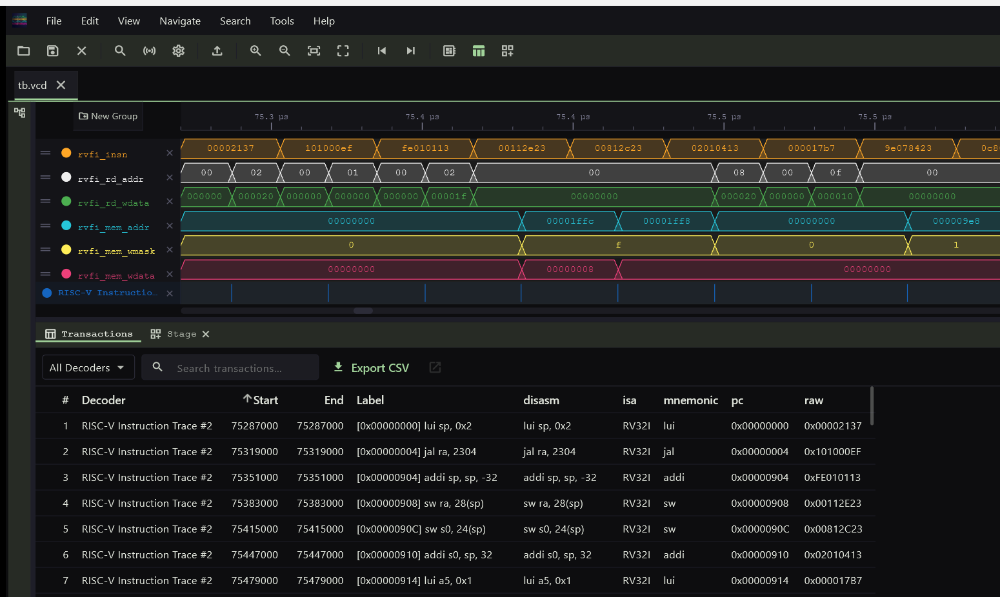
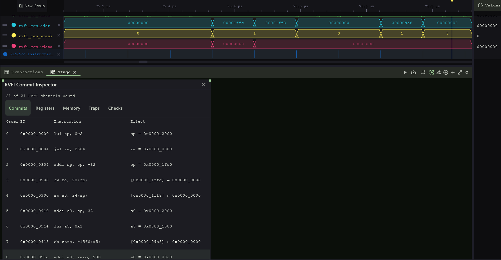
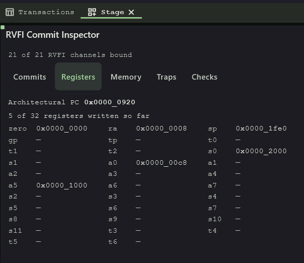
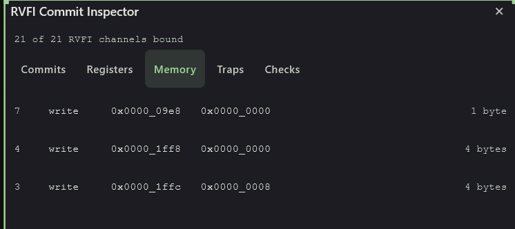
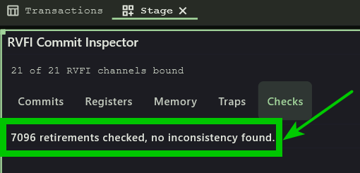

# eduBOS5

<p align="center">
  <a href="https://github.com/tarik-ibrahimovic/eduBOS5"></a>
</p>

[eduBOS5](https://github.com/tarik-ibrahimovic/eduBOS5) is Chili.CHIPS' compact RV32I RISC-V core, now open source under BSD-3-Clause. The openPCIE SOC uses eduBOS5 (default) or PicoRV32:

| | eduBOS5 (default) | PicoRV32 |
|---|---|---|
| openXC7 build | `make` | `make CPU=picorv32` → `build_artifacts.*picorv32*/` |
| co-simulation | `make run` | `make CORE=picorv32 run` |
| ISS timing model | `make CPU=iss run` | `make CPU=iss CORE=picorv32 run` |
| lint, LEQ | `bash run-lint.sh` | `CPU=picorv32 bash run-lint.sh` |
| x0 = 0, FPGA (default) | `TARGET_IS_ASIC=0`: register file RAM starts at 0 | `TARGET_IS_ASIC=0`: register file RAM starts at 0 |
| x0 = 0, ASIC | `TARGET_IS_ASIC=1`: read mux | `TARGET_IS_ASIC=1`: read mux |

x0 is never written, so it must read 0 from the start. An FPGA RAM has a power-up value (its INIT); an ASIC does not, hence the mux.

`riscv_pcie_soc.sv` connects it to the dual-port SOC RAM without a mux between instruction and data: instruction fetch on port B (read-only), loads and stores on port A through the SOC memory bus, which it shares with the CSR. PicoRV32 has one bus for both, on port A.

| File | |
|---|---|
| `edubos5.sv` | the core: control FSM, decode, load/store |
| `edubos5_alu.sv` | ALU, registered output |
| `edubos5_rf.sv` | register file: 2 asynchronous read ports, 1 synchronous write port |
| `edubos5_pkg.sv` | common types and opcodes |
| [`formal/`](formal) | the multicycle proof: harnesses and script ([formal proving](#getting-started-with-formal-proving-a-worked-example)) |
| [`wavecrux/`](wavecrux) | the CPU's RVFI view and its pictures ([WaveCrux](#watching-the-cpu-in-wavecrux)) |

Cycles per instruction (`EN_WAIT4REGS` selects the pipeline):

| | 2-stage (`EN_WAIT4REGS=0`, default) | 3-stage (`EN_WAIT4REGS=1`) |
|---|---|---|
| ALU, branch, `jal`, `jalr`, store | 2 | 3 |
| load, eduBOS5 own: memory `ready` with `valid` | 4 | 5 |
| load in the openPCIE SOC: RAM/CSR `ready` 1 cycle after `valid` | 5 | 6 |

eduBOS5 registers `dmem_vld`, so a load requests in `WAIT_DATA`; the SOC adds one `WAIT_DATA` cycle. The SOC figures are measured on the RTL. Stores never wait.

The rv32 ISS models both (`-V EDUBOS5STG2`, `-V EDUBOS5STG3`, see [5.sim](../../../../5.sim/README.md)).

## Validation tools

| Tool | Version | Checks | Where |
|---|---|---|---|
| Vivado simulator (`xsim`) | 2026.1 | co-simulation with the firmware; the SVA multicycle check (dynamic) | [5.sim](../../../../5.sim/README.md), `` `define EDUBOS5_MCP_CHECK `` |
| rv32 ISS | 1.3.3, modified | instruction-level model, cycle-exact against the RTL | [5.sim](../../../../5.sim/README.md), `make CPU=iss` |
| Verilator | 5.052 | lint; accepts the SVA too (`--assert`) | `run-lint.sh` |
| Verible | v0.0-4296-g0f262651 | style lint, format | `run-lint.sh`, `run-format.sh` |
| Yosys + slang (`read_slang`), openXC7 v1.0.0 | 0.69 | lint; equivalence (LEQ): an RTL change keeps behaviour | `run-lint.sh`, `run-leq.sh` |
| ABC `pdr` (`yosys-abc`) | 1.01, in Yosys 0.69 | the static multicycle proof, unbounded | [`formal/run-mcp-formal.sh`](formal/run-mcp-formal.sh) |
| ABC `bmc3` (`yosys-abc`) | 1.01, in Yosys 0.69 | bounded runs: the negative tests, the miter | [`formal/run-mcp-formal.sh`](formal/run-mcp-formal.sh) |
| Vivado | 2026.1 | timing with the multicycle constraint; Fmax, area | [`edubos5.3STG-ONLY.mcp.xdc`](edubos5.3STG-ONLY.mcp.xdc) |
| openXC7 (nextpnr) | v1.0.0 | Fmax, area | [4.build/hw_build.openXC7](../../../../4.build/hw_build.openXC7/README.md) |
| WaveCrux | 1.0.1 | retired instructions, decoded and cross-checked (RVFI) | [Watching the CPU in WaveCrux](#watching-the-cpu-in-wavecrux) |
| EBMC | 6.1 | declarative SVA; cannot read eduBOS5 yet: a typed parameter bug ([diffblue/hw-cbmc#2274](https://github.com/diffblue/hw-cbmc/issues/2274), gotcha 6) | tried |
| SymbiYosys (`sby`) | v0.69 | riscv-formal | next |

The scripts named `run-*.sh` are in [4.build/hw_build.openXC7](../../../../4.build/hw_build.openXC7). Board tests are still to come.

## CPU options compared: the SOC only

**Scope:** `riscv_pcie_soc` only, not the PCIE stack: the CPU, the 8 KB RAM and the CSR. The CSR has 9 registers, so a 9-input read mux, registered at its output (`soc_csr.sv`); only the RAM/CSR select after it is combinational. Built 2026-10-16, the same firmware, x4 build, CPU picked with `make`, `make CPU=edubos5_3stg`, `make CPU=picorv32` ([openXC7](../../../../4.build/hw_build.openXC7/README.md#cpu-options-compared)). The entire design, openXC7 against Vivado: [openXC7 README](../../../../4.build/hw_build.openXC7/README.md#openxc7-compared-with-vivado-the-entire-design).

| | PicoRV32 | eduBOS5 2-stage | eduBOS5 3-stage |
|---|---|---|---|
| IPC on this firmware | 0.18 (1x) | **0.35 (1.9x)** | 0.26 (1.4x) |
| Fmax, openXC7 v1.0.0 | 151.9 MHz | 138.6 MHz | 149.4 MHz |
| Fmax, Vivado 2026.1 estimate | **238.0 MHz** | 205.7 MHz | 197.7 MHz; 224.1 MHz with multicycle paths |
| MIPS = IPC × Vivado Fmax | 43 | **72** | 58, with multicycle paths |
| Vivado critical path | RAM -> `reg_out` | RAM -> ALU adder | RAM -> ALU adder; with multicycle paths `shamt_reg` -> RAM instruction address |
| CPU LUT (incl. LUT-RAM) / FF, Yosys / Vivado | 961 / 966, 431 / 416 | 818 / 907, 468 / 456 | 802 / 917, 470 / 454 |
| SOC LUT (incl. LUT-RAM) / FF, Yosys / Vivado | 1323 / 1038, 731 / 714 | 1214 / 975, 802 / 755 | 1198 / 986, 804 / 753 |
| BRAM / DSP48 | 2 / 0 | 2 / 0 | 2 / 0 |
| Co-simulation result at, 62.5 MHz | 667.2 µs | **389.5 µs** | 470.9 µs |

- PicoRV32 with `BARREL_SHIFTER=0`, `ENABLE_COUNTERS=0`, as in [`riscv_pcie_soc.sv`](../riscv_pcie_soc.sv).
- The board needs 62.5 MHz; all three pass with margin. openXC7 Fmax is nextpnr's report. It varies between builds: the 2-stage gave 138.6 and 158.4 MHz in two builds of the same RTL. nextpnr cannot apply multicycle paths.
- Vivado reports no Fmax. Its figure here is 1 / (4.545 ns - WNS), with the CPU clock constrained to 220 MHz. Vivado stops optimising once the target is met, so PicoRV32 and the 3-stage with multicycle paths could go higher. Its area is at that target too.
- Yosys area: `synth_xilinx` of `riscv_pcie_soc` in context, CPU kept as its own hierarchy. Vivado: `report_utilization -hierarchical`.
- Co-simulation: the same firmware ([5.sim](../../../../5.sim/README.md#what-they-cost)). The result time includes the PCIE link-up, so it improves less than IPC.
- The data bus is lightly loaded: RAM and CSR only, no interconnect mux; a larger SOC lengthens the CPU's external paths. The RAM is dual-ported: eduBOS5 fetches on port B and loads/stores on port A, with no I/D mux; PicoRV32 uses port A for both. The RAM is comparatively large (8 KB, 2 RAMB36), and eduBOS5's critical paths start or end at it.

### Experiment: CSR read without its output register

By default the CSR registers its read data and ready, so every CSR access takes 1 cycle more. `` `define SOC_CSR_RD_COMB `` (`soc_csr.sv`, `RD_FLOP=0`) answers straight from the 9-input read mux, in the request cycle. Does the flop favour one CPU?

| Flop (default) / comb | PicoRV32 | eduBOS5 2-stage |
|---|---|---|
| Fmax, openXC7 v1.0.0 | 151.9 / 165.4 MHz | 138.6 / 149.0 MHz |
| Fmax, Vivado 2026.1 estimate | **238.0 / 231.0 MHz** | 205.7 / 197.2 MHz |
| Vivado critical path, comb | `mem_addr` -> CSR read mux -> instruction decode | RAM -> ALU, as with the flop |
| SOC LUT / FF, Vivado | 1038 / 714, 1061 / 681 | 975 / 755, 990 / 722 |
| Co-simulation result at | 667.2 / 664.4 µs | 389.5 / 386.7 µs |

- **The critical path tells, not the Fmax figure.** Without the flop, PicoRV32's worst path runs through the read mux, because PicoRV32 decodes the read data in the same cycle: the CSR flop is what keeps it off. eduBOS5 registers the read data first, so its worst path stays RAM -> ALU and never touches the CSR.
- **The figures alone are within noise.** Both PicoRV32 runs met the 220 MHz target, so Vivado stopped optimising and both are lower bounds; the 7 MHz gap proves nothing by itself. eduBOS5's 8.5 MHz drop is on a path the change did not touch, so it can only be place-and-route variation. The openXC7 rise on both is noise too: nextpnr's Fmax varies more than that between builds.
- **9 registers is a small CSR, but a good model of peripherals.** Each register stands in for a peripheral answering on the bus: 9 peripherals plus the RAM. Peripherals and CSRs are typically flopped at their output, as here.
- The comb read saves 33 FF (the 32-bit read data and ready) and costs up to 23 LUT.
- Both pass the co-simulation, but the result comes under 1% sooner: the PCIE link, not the CSR accesses, sets the pace.
- Same setup as the table above, built 2026-10-16. The default stays the flop.

## Watching the CPU in WaveCrux

[WaveCrux](https://github.com/Ferrite-Engineering/wavecrux) by Ferrite Engineering decodes RISC-V: it disassembles each retired instruction, and its RVFI Commit Inspector replays and cross-checks the whole run. Both read the CPU through RVFI, the [riscv-formal](https://github.com/YosysHQ/riscv-formal) interface: a standard set of `rvfi_*` signals that a core raises once per retired instruction.

eduBOS5 and PicoRV32 have RVFI outputs, built with `` `define RISCV_FORMAL `` (simulation and formal only). [`wavecrux/soc_cpu_view.sv`](wavecrux/soc_cpu_view.sv) shows them under the standard names, whichever CPU the SOC has:

```sh
cd 5.sim
make run USRSIMOPTS="--define DUMP_VCD --define DUMP_SOC_CPU"   # -> tb.vcd, signals under tb.cpu_view
```

Then open [`5.sim/tb.RISCV-ISA.wavecrux`](../../../../5.sim/tb.RISCV-ISA.wavecrux) in WaveCrux 1.0.1: the rows, the decoder and the inspector come bound.

**The decoded instructions** (View -> Toggle Transactions Panel). eduBOS5 leaves reset at PC 0, sets the stack, jumps to `main` at `0x904` and builds its frame:

<p align="center">

</p>

**The RVFI Commit Inspector** (View -> Toggle Stage Panel). Each commit with its effect: the register written, or the store `[0x0000_1ffc] <- 0x0000_0008`:

<p align="center">

</p>

Its Registers tab rebuilds the register file from the RVFI writes: the state at the cursor, after 9 instructions, with the PC of the next one.

<p align="center">

</p>

Its Memory tab lists every access up to the cursor, newest first, with address, data and size. Commit 7 is `sb zero, -0x618(a5)`: one byte at `0x9e8`.

<p align="center">

</p>

Its Checks tab checks all 7,096 instructions of the run for consistency, memory access, retirement order and traps included:

<p align="center">

</p>

This is a dynamic riscv-formal, and an appetizer for it: the same RVFI record, checked on the one run the firmware made. riscv-formal checks it against the ISA for every possible instruction sequence; a riscv-formal section will follow this one.

With these views, the [rv32 ISS](../../../../5.sim/README.md#the-three-cpu-options) loses most of its value-add for debugging: the instruction trace, register writes and memory accesses now come from the RTL core itself, cycle-true. What the ISS still adds is source-level stepping in gdb.

What to know:
- eduBOS5 retires an instruction in `FETCH_INSTR`, one every 2 clocks. The CPU starts at 75.3 µs: it waits in reset until the PCIE link is up.
- eduBOS5 has no traps or interrupts, and runs in machine mode: `rvfi_trap`, `rvfi_halt`, `rvfi_intr` stay 0. A `SYSTEM` instruction halts the core and does not retire.
- The decoder row on the waveform shows only a tick per instruction: WaveCrux gives each one zero width. Read the disassembly in the Transactions panel.

To set it up by hand, on another VCD:
1. Display format: right-click a value in the Value column -> Display Format -> Hexadecimal.
2. Decoder: Ctrl+Shift+D -> RISC-V Instruction Trace; bind `clk`, `instruction`, `valid`, `pc` to `rvfi_clk`, `rvfi_insn`, `rvfi_valid`, `rvfi_pc_rdata`; XLEN 32, no extensions.
3. Inspector: View -> Toggle Stage Panel -> Add Widget -> Instrument -> RVFI Commit Inspector. Click the widget, then bind the `rvfi_*` signals one by one in Signal Bindings; Auto-Bind does not find them yet. Bind `rvfi_order` too, or the Commits list stops after two rows.

## 3-stage multicycle paths

[`edubos5.3STG-ONLY.mcp.xdc`](edubos5.3STG-ONLY.mcp.xdc) gives Vivado 2 cycles from the instruction port and the register file. That is only safe if the RTL really gives those paths 2 cycles. The next section proves it, step by step.

## Getting started with formal proving: a worked example

This is how the multicycle constraint above was proven, gotchas included. It is meant as a first exercise in formal verification (FV). Everything runs with open-source tools.

### 1. State the claim in plain words

In the 3-stage pipeline an instruction moves `FETCH_INSTR` → `WAIT4REGS` → `EXECUTE`. The instruction word (`imem_rdat`) and the register-file reads (`rs1`, `rs2`) change on the edge that ends `FETCH_INSTR`: the **launch** edge. The constraint is safe if:

1. **Source side:** they change only on the launch edge, and hold for 2 clocks.
2. **Capture side:** whatever a register captures from them on the 1st edge after launch is never used. Only the 2nd edge counts.

Both are needed. Point 1 alone is not enough: see gotcha 3.

### 2. Write it as assertions

The source side in SVA, under `` `define EDUBOS5_MCP_CHECK `` in `edubos5.sv`:

```systemverilog
$changed({imem_rdat, rs1, rs2}) |-> $past(state) == FETCH_INSTR   // change only at launch
state == FETCH_INSTR |-> ##2 $stable({imem_rdat, rs1, rs2})       // hold 2 clocks
```

These are *declarative* (concurrent) assertions: they say what must hold over time, not how to check it.

### 3. Dynamic proof: simulation

```sh
cd 5.sim && make run CORE=edubos5_3stg USRSIMOPTS="--define EDUBOS5_MCP_CHECK"
```

Vivado XSIM checks the assertions on every clock of the firmware run: 0 errors. Verilator 5.052 accepts them too (`--assert`).

**Limit: coverage.** A simulator checks only what it runs. An instruction sequence the firmware never runs is never checked.

### 4. Static proof: formal

A formal tool checks **every** input sequence from reset, with no test vectors. You give it three things:

| What | Here | File |
|---|---|---|
| The design | the eduBOS5 core, unchanged | `edubos5.sv` |
| A harness: free inputs and assumptions | any instruction word, any data; a synchronous RAM model; a 2-clock reset | `formal/edubos5_mcp_formal.sv` |
| The properties | the two above, plus the capture side ([section 7](#7-the-lesson-rtl-and-formal-help-each-other)) | `edubos5.sv`, `` `define EDUBOS5_MCP_FORMAL `` |

```sh
bash formal/run-mcp-formal.sh source      # Property proved.
```

**Limit: syntax.** The open-source formal front ends do not read declarative SVA. With Yosys 0.69 (openXC7 v1.0.0), `read_slang` and `read_verilog -formal` both reject `assert property (@(posedge clk) ...)`; `read_slang` also rejects `$changed` and `$stable`; sv-elab `main` accepts them in immediate asserts ([sv-elab#382](https://github.com/povik/sv-elab/pull/382)), but still not concurrent SVA. That is a known gap of the open-source Yosys flow, not a bug: full SVA there needs the commercial Verific front end. So the formal copy uses immediate asserts and `$past` only:

| SVA (simulation) | Immediate form (formal) |
|---|---|
| `p \|-> ##2 q` | `if ($past(p, 2)) assert (q);` |
| `$stable(x)` | `x == $past(x)` |
| `$changed(x)` | `x != $past(x)` |

Both copies stay in the RTL, side by side.

### How a formal tool answers: examples and counterexamples

A formal tool does not run tests. It searches all inputs, over all clocks, for a **counterexample**: a trace from reset that breaks an assertion while obeying every assumption.

- **Counterexample found:** the property is false. You get the trace (a waveform, VCD). Read it like a failing simulation: which input, which clock, which signal went wrong.
- **None up to N clocks** (BMC, `bmc3 -F N`): no failure exists in the first N clocks. A bounded proof.
- **None ever** (k-induction, PDR): the property holds on every reachable state. A full proof.

An **example** (a *cover*, or *witness*) is the opposite question: "show me one trace where X happens". Use it to check that the harness can reach what matters: a launch, a load, a store. A proof is worth only as much as the examples it covers. If the tool cannot produce one, the proof is vacuous (gotcha 1).

A counterexample is either:
- **a real bug**: fix the design, or the claim; or
- **an impossible input**: the harness allows something the real system never does. Add an assumption for it, and write down why (gotcha 7).

Every assumption narrows what the proof covers. Keep them few, and true for the system the design really sits in.

### 5. The capture side: why one DUT is not enough

Before the clock enable of section 7, eduBOS5 loaded its pipeline registers on every clock, so they *did* load at the 1st edge after launch, and the 2nd edge overwrote them. The claim is that the 1st-edge value never matters. That compares two runs, one with good data and one with junk, so no property of one run can state it.

**The miter, in general:** two copies of the design get the same inputs, except for the one thing under test. An assertion says their outputs always match. It answers "does X matter?" questions, and is the classic tool for equivalence checks.

**Here** (`formal/edubos5_mcp_miter.sv`), copy B got junk instructions in the cycle after each launch. It made the 2-stage core fail at clock 6 in 0.1 s, and its counterexamples found the [Bonus goodies](#bonus-goodies-from-fv). But for the 3-stage core it was slow, and it needed bus assumptions and helper invariants that are hard to get right (gotchas 7, 8). No full proof. **Not a good method for this problem:** [section 7](#7-the-lesson-rtl-and-formal-help-each-other) gets the answer from one DUT, after a small RTL change.

### 6. Results

| Check | 3-stage | 2-stage (paths are 1 cycle) |
|---|---|---|
| Source side, simulation (one firmware run) | 0 errors | 0 errors |
| Source side, formal | proved, 235 s, in one run with the last row | proved |
| Capture side, miter | not proven: bounded runs only, 38 min (gotcha 8) | fails at clock 6, 0.1 s |
| Capture side, one DUT, with a clock enable ([section 7](#7-the-lesson-rtl-and-formal-help-each-other)) | proved, 235 s, in one run with the source side | fails at clock 6, 1 s |

The 2-stage column is the **negative test**: it must fail somewhere, and only a capture-side check makes it fail.

### Gotchas

1. **A proof can pass because nothing happens (vacuity).** The first harness let the instruction RAM change only when its address changed. After reset `pc` stays 0, so the instruction word stayed at its power-up value 0. Opcode 0 decodes as `SYSTEM`, which halts the core. Every check "passed" on a core that never ran. **Fix:** leave the RAM free during reset. **Habit:** add an assertion that must fail (here: "no launch ever happens") and check that it does.
2. **Reset and `$past`.** In the first clocks, `$past(x)` refers to cycles before reset. The checks failed there on garbage. **Fix:** check only from the clock after reset (`fv_on`). Tools also differ on power-up: Yosys `sat -set-init-zero` starts every flip-flop at 0, while the AIGER flow leaves flip-flops without `init`, including the hidden `$past` ones, free. The same harness passed in one flow and failed in the other. The script now sets every power-up value to 0 (`setundef -init -zero`).
3. **Necessary is not sufficient.** The 2-stage core passes the source side too: its sources also hold 2 clocks. Only a negative test shows that the property does not prove the claim. The capture side is what tells the two apart (section 5).
4. **Don't mix harnesses.** With the core's own source checks enabled in the miter, copy B's checks fire on the junk the miter injects on purpose: a false failure.
5. **Pick an engine that scales.** Yosys's built-in `sat` proved the source side in seconds, but on two cores it needed 15 minutes for 7 clocks. ABC's `pdr` and `bmc3` (in openXC7's Yosys build) are much faster: BMC found the 2-stage counterexample in 0.1 s.
6. **Front ends have bugs too.** `read_slang` cannot reach an enum constant through a hierarchical name (`u_a.FETCH_INSTR`); use its value. EBMC 6.1 mistypes a `parameter bit` passed down the hierarchy and cannot elaborate this core ([diffblue/hw-cbmc#2274](https://github.com/diffblue/hw-cbmc/issues/2274)). Work around them in the harness, never in the RTL.

7. **Read every counterexample.** The 3-stage miter first failed at clock 9:
   1. `dmem_rdy` was already high in a load's `EXECUTE`, so the core skipped `LOAD_DATA` (the FSM's `EXECUTE` branch in `edubos5.sv`).
   2. It then selected the load's byte lane with a `dmem_addr` built from a 1st-edge value.

   That is a real path through the multicycle constraint. But in this SOC, `dmem_rdy` only follows a pending read (`riscv_pcie_soc.sv`, `load_wait`), so the path cannot occur. The harness now assumes that bus rule.

   The next counterexample, at clock 10, needed a store with an illegal `funct3` (111). The core then issues a bus cycle without write strobes. The SOC takes it for a read and answers with `dmem_rdy`, which reaches the next load's `EXECUTE`. GCC never emits that encoding, so the harness now assumes legal RV32I stores.

   **Lesson:** each assumption is part of the result. The proof holds for this SOC's bus and for legal code. A SOC whose `dmem_rdy` can be high in `EXECUTE` breaks the constraint. Formal also found a robustness issue no simulation had: an illegal store corrupts the next load.

8. **Formal blows up fast.** The work grows with the state and with the depth:

   | Model | Free inputs | State bits | AND gates | Asserts | Run |
   |---|---|---|---|---|---|
   | One core, 3-stage, with `go2exec` | 66 | 2,022 | 15,411 | 6 | PDR: proved in 235 s |
   | One core, 2-stage | 66 | 1,868 | 14,212 | 5 | BMC: fails at clock 6 in 1 s |
   | Miter, two 3-stage cores | 98 | 3,116 | 28,251 | 6 | BMC: 20 min to reach clock 10; 38 min not enough for 14 |
   | Miter, two 2-stage cores | 98 | 3,048 | 26,065 | 6 | BMC: fails at clock 6 in 0.1 s |

   Size of the model ABC checks: `bash formal/run-mcp-formal.sh source 1 print_stats`. State bits are flip-flops, including the hidden ones behind `$past`. A counterexample is quick to find when it is short; a full proof must cover every state.

   Each extra clock adds a full copy of the design to the problem, and a miter makes the tool relate two cores bit by bit, register file included. The textbook fix is *helper invariants*: assert what you know, e.g. both cores always have the same `pc`, `state` and register file, so the induction does not have to discover it. Here they did not close the proof, and one helper written by hand was simply wrong: BMC refuted it at clock 7. Helpers must be exact. The better fix is a smaller problem (section 7).

### 7. The lesson: RTL and formal help each other

**RTL helps formal.** The capture side needed two DUTs only because the pipeline registers load on every clock, junk included. Give them a clock enable, so that in the 3-stage pipeline they load only at the edge that ends `EXECUTE`. Then nothing fed by the sources loads at the 1st edge after launch, and that is a property of one DUT, as small as the source side:

```systemverilog
state == FETCH_INSTR |-> ##2 $stable({rs1_reg, rs2_reg, instr_decode_reg, ...})   // the 1st edge after launch loads nothing
```

It needs only the source-side harness: no miter, no helper invariants, no bus assumptions. **Done:** the enable is `go2exec` ([Bonus goodies](#bonus-goodies-from-fv), item 3). Source and capture side together prove in 235 s, where the miter ran 38 minutes without a proof. The 2-stage core fails it, as it must: there the 1st edge after launch is the one that ends `EXECUTE`. The cost: 2 LUTs and 1 FF, and no Fmax loss ([CPU options compared](#cpu-options-compared-the-soc-only)).

**Formal helps RTL.** The miter's counterexamples found two weaknesses no simulation had shown: [Bonus goodies](#bonus-goodies-from-fv) below. Both have small RTL fixes too.

Both directions follow one habit: when a property is hard to prove, ask whether the RTL could make it easy, and when a proof fails, ask whether the RTL should be more robust.

### Bonus goodies from FV

Formal found two things in eduBOS5 itself, beyond the multicycle constraint, and pointed to a third improvement:

1. **An illegal store goes unnoticed.** A store with `funct3` 3 to 7 issues a bus cycle without write strobes. The SOC takes it for a read: a CSR or FIFO with read side effects loses data, and the `dmem_rdy` it returns makes the next load write a stale value. GCC never emits such a store, but a jump into data or corrupted code does. **Proposal:** an illegal-instruction trap: reject unknown opcodes and `funct3` values instead of executing them.
2. **A hidden bus assumption.** In `EXECUTE`, the 3-stage core takes any `dmem_rdy` as the answer to the current load and skips `LOAD_DATA` (the FSM's `EXECUTE` branch in `edubos5.sv`). That is only right if `dmem_rdy` is a one-cycle pulse that answers a pending read, and is never high before it or held after it. The openPCIE SOC guarantees this (`load_wait` in `riscv_pcie_soc.sv`). An always-ready memory does not, and then loads return stale data and the multicycle constraint is unsafe. **Proposal:** document this rule at the `dmem_rdy` port and in this README.
3. **A capture side that is hard to prove.** The 3-stage pipeline registers loaded junk at the 1st edge and relied on the 2nd to overwrite it. **Done:** a clock enable, `go2exec`, a flop in the 3-stage build only, loads them only at the edge that ends `EXECUTE` ([section 7](#7-the-lesson-rtl-and-formal-help-each-other)). It makes the RTL more robust:
   - The constraint is safe by construction: nothing loads an unsettled value. Before, it was safe only because every 1st-edge value happened to be overwritten before use, so any new logic that read these registers in `EXECUTE` could break it unnoticed.
   - `dmem_addr` is never built from an unsettled value, which removes the multicycle part of finding 2.
   - It does not fix finding 1: an illegal store still makes a bus cycle without write strobes.

### Open-source formal tools

| Tool | What it is | Reads declarative SVA? |
|---|---|---|
| Yosys `sat` | built-in SAT solver: BMC and k-induction | no, front end as below |
| Yosys `read_slang` / `read_verilog -formal` | front ends for the tools below | no: immediate asserts, `$past`. The `$changed`/`$stable` rejection is already fixed on sv-elab `main` ([sv-elab#382](https://github.com/povik/sv-elab/pull/382)) |
| ABC (`pdr`, `bmc3`) | model checker on the gate-level netlist; used here | no, takes the netlist |
| SymbiYosys (SBY) + Yices, Z3, Bitwuzla, Boolector | driver around Yosys with SMT solvers | only with the commercial Verific front end |
| EQY | equivalence checking with Yosys | no |
| rIC3, AVY, Pono | model checkers on AIGER / BTOR2 netlists | no, take a netlist |
| [EBMC](https://www.cprover.org/ebmc/) | model checker with its own SystemVerilog front end | **yes** |
| [Spot](https://spot.lre.epita.fr/) | library from LRE/EPITA (`ltl2tgba`) that turns temporal formulas into automata; EBMC needs it for unbounded proofs of SVA sequences such as `##2` | not a checker; a helper for EBMC |
| Verilator | simulator, no formal | accepts it, checks it in simulation only |

**Why EBMC:** every other open-source tool reads a netlist made by Yosys, so it inherits Yosys's SVA limits. EBMC is the only one with its own SVA front end, so it is the candidate for proving the declarative assertions as written.

EBMC 6.1 status here:
- It proves `$changed |-> $past` both bounded (BMC) and unbounded.
- For `|-> ##2` it gives bounded proofs only. Its unbounded engines need Spot, which is not in Ubuntu's apt.
- It cannot read eduBOS5 yet (gotcha 6).

EBMC's sister tools are CBMC (C/C++) and JBMC (Java), for software.

## Future improvement ideas

- **A 3-stage pipeline that pays off.** With its multicycle constraint the 3-stage core reaches about 1.09x the 2-stage clock (Vivado, 220 MHz target), but it needs about 1.35x just to break even on IPC (0.26 vs 0.35). Its critical path has already moved to a 1-cycle path, `shamt_reg` -> RAM instruction address, so the next gain has to come from there. An opportunity for future work.
- **An illegal-instruction trap**, and a documented `dmem_rdy` rule: see [Bonus goodies from FV](#bonus-goodies-from-fv), items 1 and 2.

## References

- RISC-V International, [*The RISC-V Instruction Set Manual, Volume I: Unprivileged ISA*](https://riscv.org/specifications/ratified/) -- RV32I, the base integer ISA that eduBOS5 implements.
- [tarik-ibrahimovic/eduBOS5](https://github.com/tarik-ibrahimovic/eduBOS5) -- the original core.
- [Ferrite-Engineering/wavecrux](https://github.com/Ferrite-Engineering/wavecrux) -- WaveCrux, the waveform viewer, with its built-in RISC-V instruction-trace decoder.

-----------
#### End-of-Document
