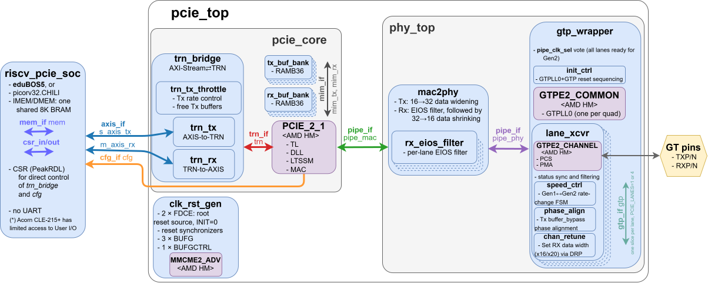
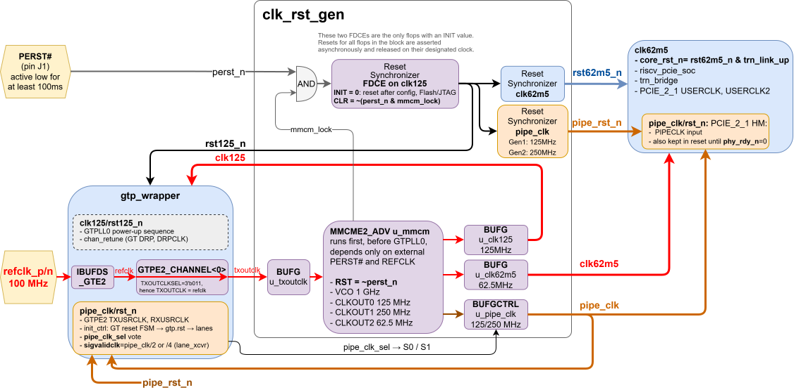

# RTL Implementation: Opensource designs

The **opensource** FPGA designs: the Artix-7 hard macros wrapped in open logic,
with no Vivado IP generator.

Their AMD/Vivado-IP counterparts are in
[`2.amd-rtl-with-Vivado-build`](../2.amd-rtl-with-Vivado-build). Each design here
has an `.amd` sibling there, built and proven first, as the reference.

### Directory Structure

- **`0.common.opensource`**
  The RTL both Root Complex designs share: the top (`RC_opensource`), the RISC-V
  SoC, the CSR wrapper, the opensource PCIE stack, the shared constraints and the
  Vivado project script. The RC folders below hold only what differs: the GT lane
  XDC per link width and a short wrapper for the shared script. Their firmware is
  in [`3.sw`](../3.sw).

- **`1.EP.opensource`**
  Opensource PCIE EndPoints to test our Root Complex against. Points to upstream
  projects (LiteFury PCIE EP, regymm's pcie_7x, LitePCIe) instead of copying them.
  The [`1.EP.amd`](../2.amd-rtl-with-Vivado-build/1.EP.amd) replica works too.

- **`2.RC-direct.opensource`** — **implemented and working**

  Root Complex for a **Direct (Point-to-Point)** link, the core of the project:
  opensource PCIE logic around the `PCIE_2_1` and `GTPE2_CHANNEL` hard macros, a
  RISC-V SoC, and its software.

  Verified on hardware: **PCIE Gen2 x4 and x1, link up and trained**, RC to EP.
  **x4 is the default**, x1 is a build option (`PCIE_LANES`). x4 can only be
  tested in this Direct topology. Builds with Vivado and with a
  [fully opensource toolchain](../4.build/hw_build.openXC7) (openXC7: Yosys,
  nextpnr, prjxray), no proprietary tool in the chain.

- **`3.Bonus--RC-switched.opensource`** — **implemented and working**

  Root Complex for a **Switched** topology (RC ⇔ Switch ⇔ EP). Verified on
  hardware through a standard PCIE switch (ASM1184e).

---

### Common CSR

Both RC designs take their register block from one SystemRDL spec,
[`4.build/csr_build/csr.rdl`](../4.build/csr_build/csr.rdl). `peakrdl` turns it
into the register RTL (`csr_pkg.sv`, `csr.sv`) and the software headers;
[`soc_csr.sv`](0.common.opensource/src/soc_csr.sv) bridges the block to the
picorv32 memory bus. Regenerate with `make -f MakefileCSR` in
[`4.build`](../4.build) ([details](../4.build/README.md#csr-hal-compilation)).

---

### SystemVerilog interfaces

Buses are SystemVerilog interfaces, all in [`0.common.opensource/src/pcie/`](0.common.opensource/src/pcie), each with one modport per side.

| Interface | Between | Carries |
|---|---|---|
| `axis_if` | SOC ⇄ `pcie_top` ⇄ `trn_bridge` | TLPs as AXI-Stream (`tdata`, `tkeep`, `tuser`, `tlast`, `tvalid`, `tready`), one instance per direction |
| `mem_if` | CPU ⇄ RAM, CSR (in `riscv_pcie_soc`) | picorv32-style memory bus (`valid`, `addr`, `wdata`, `wstrb`, `ready`, `rdata`) |
| `cfg_if` | `pcie_top` → SOC | status sideband: ERR_FATAL received, free TX buffers |
| `trn_if` | `trn_bridge` ⇄ `PCIE_2_1` (in `pcie_core`) | TLPs on the TRN bus (below) |
| `mim_if` | `PCIE_2_1` ⇄ `tx_buf_bank` / `rx_buf_bank` | packet buffer RAM port (`MIMTX*`/`MIMRX*` pins): separate write and read ports, fixed latency, one instance per direction |
| `pipe_if` | `pcie_core` ⇄ `phy_top` ⇄ `gtp_wrapper` | PIPE, as two instances: `pipe_mac` (16 bits per lane, at the MAC) and `pipe_phy` (32 bits per lane, at the GTP); `phy_top` adapts between them |

**TRN** ("transaction") is Xilinx's name for the native TLP port of the 7-series PCIE hard block (the `TRNTD`/`TRNRD`/`TRNTSOF`/... pins of `PCIE_2_1`). It predates AXI: start/end-of-frame flags and a remainder bit instead of byte enables. `trn_bridge` converts it to AXI-Stream. We use the **64-bit** TRN interface, described in AMD/Xilinx [UG477](../0.doc/xilinx/ug477_7Series_IntBlock_PCIe.pdf) (chapters 2 and 5, the 64-bit parts). TLP header fields and sideband bits are defined once, as packed structs, in [`pcie_pkg.sv`](0.common.opensource/src/pcie/pcie_pkg.sv).

The `PCIE_2_1` and `GTPE2` hard macros keep their flat pins; unused ones are tied off at the instance. Diagram source: [`0.doc/2.rtl/block-diagram.drawio`](../0.doc/2.rtl/block-diagram.drawio).

---

### Clocks and resets

[`clk_rst_gen.sv`](0.common.opensource/src/pcie/clk_rst_gen.sv) makes every clock, each with a reset asserted asynchronously and released on that clock:

| Clock / reset | Frequency | Used by |
|---|---|---|
| `clk125` / `rst125_n` | 125 MHz | GT DRP, PLL0 power-up sequence; runs before PLL0 (refclk → MMCM only) |
| `pipe_clk` / `pipe_rst_n` | 125 MHz Gen1, 250 MHz Gen2 | `PCIE_2_1` PIPECLK, GTPE2 TXUSRCLK/RXUSRCLK, GT reset FSM (`init_ctrl`) |
| `clk62m5` / `rst62m5_n` | 62.5 MHz | `PCIE_2_1` USERCLK, `pcie_top` |
| `clk62m5` / `core_rst_n` | 62.5 MHz | `trn_bridge`, SOC: made in `pcie_top` as `rst62m5_n & trn_link_up`, so held in reset until the PCIE data link is up |

`pipe_clk` switches to 250 MHz once all lanes vote for Gen2 (`pipe_clk_sel`, from `gtp_wrapper`). The single reset source is two `FDCE` with `INIT = 0`: they hold reset after configuration (flash or JTAG, which can end after PERST# is released); PERST# or a loss of MMCM lock asserts it later. Diagram source: [`0.doc/2.rtl/clk-rst.drawio`](../0.doc/2.rtl/clk-rst.drawio).

### Common Physical Constraints (XDC)

The XDC maps the PCIE signals to the pins of the `Acorn CLE-215+` and the `openPCIE Backplane`. Every design needs:

1.  **Clock Request (CRITICAL):** the backplane outputs the 100 MHz reference clock **only** while `CLKREQ#` (pin **G1**) is driven **LOW**. Without it: no clock, no link.

2.  **Reference Clock & Reset:**
    - **REFCLK:** 100 MHz, differential pair on pins **F6/E6**.
    - **PERST#:** pin **J1**, active low.

3.  **Transceiver (GTP) Placement:** each logical lane **must be locked** to its **GTP Channel Primitive** (`GTPE2_CHANNEL_X0Y...`); `PACKAGE_PIN` on the RX/TX pairs is **not enough**. The `LOC` alone **is** enough: GT pads are dedicated, so each channel site fixes its four pins. The Vivado XDC files therefore have no `PACKAGE_PIN` on GT ports. (openXC7 is the opposite: nextpnr needs the pins; see [`4.build/hw_build.openXC7`](../4.build/hw_build.openXC7/README.md#gt-channel).)

    **Finding the channel:**
    1.  Map the M.2/PCIE connector pins to FPGA **Package Pins** in the [NiteFury](https://github.com/RHSResearchLLC/NiteFury-and-LiteFury/tree/master) schematic.
    2.  In the Vivado **Device Window**, find those pins and their **GTP Channel Primitive**.

    

    | Board Lane | RX pins (P / N) | TX pins (P / N) | GT Location | GTP channel in bank 216 (openXC7 numbering) | Used by |
    | :--- | :--- | :--- | :--- | :--- | :--- |
    | Lane 0 | B10 / A10 | B6 / A6 | X0Y6 | 2 | RC-switched, RC-direct x4 |
    | Lane 1 | B8 / A8 | B4 / A4 | X0Y4 | 0 | RC-direct x4 |
    | Lane 2 | D11 / C11 | D5 / C5 | X0Y5 | 1 | RC-direct x1 and x4, EP |
    | Lane 3 | D9 / C9 | D7 / C7 | X0Y7 | 3 | RC-direct x4 |

    

    Pin names are from AMD's package file [`xc7a200t-fbg484-package.txt`](../0.doc/xilinx/xc7a200t-fbg484-package.txt) ([source](https://www.xilinx.com/support/packagefiles/a7packages/xc7a200tfbg484pkg.txt)) (`MGTPRXP<n>_216` etc.). An x1 design uses one of the four positions for its lane `[0]`; x4 uses all four.

> **Note:** The AMD XDC files in [`2.amd-rtl-with-Vivado-build`](../2.amd-rtl-with-Vivado-build) have a `LOC` block for all 4 positions, with only the active one **uncommented**. The opensource designs carry only their active `LOC`s, in the per-variant lane XDC; all other constraints are shared, in [`0.common.opensource/xdc`](0.common.opensource/xdc). Neither has GT pin constraints.

4.  **Visual Debug (LEDs):** status signals such as `trn_link_up` drive the 4 **User LEDs** (pins **G3, H3, G4, H4**).

### Utilization and Timing Stats

openXC7 v1.0.0 build (Yosys `read_slang` + nextpnr-himbaechel) of the opensource RC, part `xc7a200tfbg484-3`: **x4 Gen2**, the default (`make`), and x1 Gen2 (`make LANES=1`) for reference.

| Resource | x4 Gen2 (default) | x1 Gen2 |
|---|---|---|
| LUTs (`SLICE_LUTX`) | 2,641 | 2,246 |
| Flip-flops (`SLICE_FFX`) | 2,230 | 1,588 |
| `CARRY4` | 109 | 90 |
| `RAMB36E1` (BRAM) | 10 | 10 |
| `PCIE_2_1` | 1 | 1 |
| `GTPE2_CHANNEL` | 4 | 1 |
| `GTPE2_COMMON` | 1 | 1 |
| `MMCME2_ADV` | 1 | 1 |
| `BUFGCTRL` (BUFG + BUFGCTRL) | 4 | 4 |

| Clock | Target | Fmax, x4 Gen2 | Margin, x4 Gen2 | Fmax, x1 Gen2 |
|---|---|---|---|---|
| `pipe_clk` | 250 MHz (Gen2) | 311.24 MHz | +24% | 310.66 MHz |
| `clk125` | 125 MHz | 379.51 MHz | +204% | 382.85 MHz |
| `clk62m5` | 62.5 MHz | 170.01 MHz | +172% | 175.69 MHz |

All clocks meet target. Fmax is nextpnr's estimate and varies with placement.

### RTL coding rules

IEEE 1800-2009 SystemVerilog. For the opensource RTL and the models that stand in for it:

- **One place for bit positions:** TLP header fields and sideband bits are packed structs in [`pcie_pkg.sv`](0.common.opensource/src/pcie/pcie_pkg.sv). Use their members, never raw slices like `tdata[30:29]`. Reserved bits are `rsvd0`, `rsvd1`, ..., so each struct spans its full width.
- **Declare and size once:** widths, constants and types live in a `_pkg` (e.g. `TRN_DATA_W` in `pcie_pkg.sv`); no module redeclares them.
- **Fewer, richer ports:** interfaces and struct-typed ports, not many scalars; group internal signals the same way.
- **Packages:** `import` right after the module name, no package prefix on every use.
- **Case:** signals and ports lower case, constants UPPER CASE (parameters, localparams, enum values, macros). Only vendor hard-macro and primitive pins (`PCIE_2_1`, `GTPE2_CHANNEL`, `MMCME2_ADV`, ...) keep vendor names.
- **Descriptor names:** a signal of a `pcie_pkg` header or sideband type is named `*_dw0` ... `*_dw3`, `*_hdr_*` or `*_tuser` (e.g. `rx_hdr_dw0`, `tx_cfg_dw2`). It reads only the fields it needs; `run-lint.sh` waives the unread fields by that name.
- **Procedural blocks:** `always_ff` for flip-flops, `always_comb` for combinational logic, never plain `always`. `unique case` for parallel muxes whose items cover every value, `unique0 case` where no item may match, `priority case` for priority encoders; never plain `case`. A `unique case` has no `default`.

  | Keyword | Several items match | No item matches | Synthesis meaning |
  |---|---|---|---|
  | `unique` | violation | violation, unless there is a `default` | `parallel_case` + `full_case` |
  | `unique0` | violation | allowed, nothing happens | `parallel_case` only |
  | `priority` | first one wins | violation, unless there is a `default` | ordered (priority) logic |

  `unique0` (IEEE 1800-2009) is the simulation-aware `parallel_case`; the old work-around, `unique case` with an empty `default`, is not used.
- **`logic`, not `wire`:** every signal and port is `logic`, every `input`/`output` typed (`input logic ...`), never left to default to `wire`. Only an `inout` would be a `wire`; there are none. `wire x = expr;` becomes `logic x;` + `assign x = expr;` (`logic x = expr;` is only an initial value).
- **`initial` blocks:** not in RTL, except `$readmemh` of the firmware into the SOC RAM. Models and test benches (`5.sim`) may use them freely.
- **No `` `timescale `` in RTL:** the test bench sets it (`5.sim/tb.sv`, and `--timescale 1ps/1ps` for xelab in `5.sim/Makefile`). RTL has no `#` delays; a directive in only some files is a lint finding (Verilator TIMESCALEMOD).
- **No initial values on registers:** a register gets its value from the reset branch of its `always_ff`. The one exception is the design's reset source, two `FDCE` instances in `clk_rst_gen.sv` (`u_rst_sync0/1`), instantiated by name so it stands out: their `INIT` asserts reset at configuration (flash or JTAG, which can end after PERST# is released); PERST# asserts it later. Every other reset derives from it.
- **Arrays, not flat buses:** arrays of lanes or structs, no index arithmetic on flat buses.
- **`/*LINT:OK*/`:** marks an unused *output* pin of a hard macro, primitive or third-party core as reviewed: `.PIN (/*LINT:OK*/)`, with a `// reason` if not obvious. Never on an input (`run-lint.sh` flags it); unused inputs are tied off.
- **No-connects:** unused bits of a hard-macro or primitive output go to `NC_` signals: `{NC_x, used}` on a bus pin, or an `NC_` signal for an unused lane. `NC_` signals are never read.
- **Lint:** fix findings at the root; waive only as a last resort, as described in [`run-lint-waivers.txt`](../4.build/hw_build.openXC7/run-lint-waivers.txt). Don't mold legal, intended code around one tool's quirk (e.g. slang on `unique case` with a `default`, Verilator on unpacked-struct members written by separate processes): waive it with a reason instead.
- **Models follow the RTL:** a model keeps the ports, interfaces, structs, loops and names of the RTL it replaces.
- **Formatting:** [`run-format.sh`](../4.build/hw_build.openXC7/run-format.sh) puts every `if`, `else`, `always`, `for` and `initial` body in `begin` ... `end`, even a single statement, then runs Verible (`verible-verilog-format`) at its defaults plus all alignment options set to `align`, `end` and `else` on separate lines, LF line endings (flags in the script). Lines are at most 100 columns; wrap longer ones by hand. Run it last, after lint, before a commit. `run-format.sh --check` only lists unformatted files; the `Verible` GitHub Action runs that check and the Verible lint.

### References

- IEEE Std 1800-2009, *IEEE Standard for SystemVerilog -- Unified Hardware Design, Specification, and Verification Language*.
- Clifford E. Cummings, [*SystemVerilog-2009 Enhancements: Priority/Unique/Unique0*](https://dvcon-proceedings.org/wp-content/uploads/systemverilog-2009-enhancements-priority-unique-unique.pdf), DVCon -- `unique`, `unique0` and `priority` versus the `full_case` / `parallel_case` directives.
- Xilinx UG477, [*7 Series FPGAs Integrated Block for PCI Express*](../0.doc/xilinx/ug477_7Series_IntBlock_PCIe.pdf) -- the `PCIE_2_1` hard block and its TRN interface.
- Xilinx UG482, [*7 Series FPGAs GTP Transceivers*](../0.doc/xilinx/ug482_7Series_GTP_Transceivers.pdf) -- `GTPE2_CHANNEL` / `GTPE2_COMMON`: PLL0, TXOUTCLK, DRP, the PIPE-side clocking and reset sequence.

----------
#### End-of-Document
