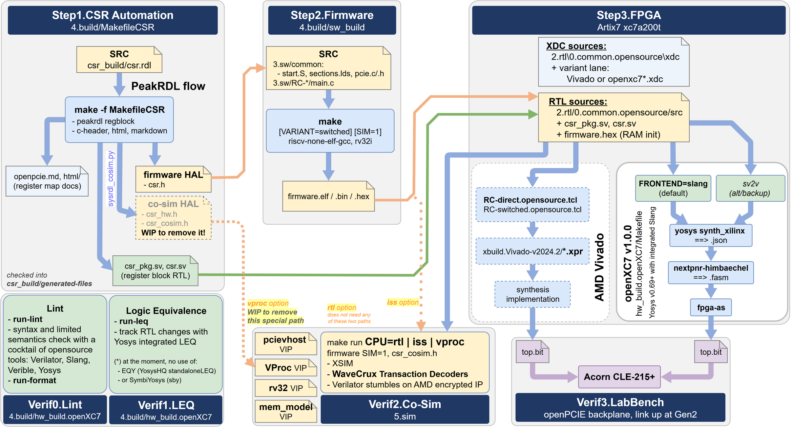

# _openPCIE_ Build

The build process for the _openPCIE_ project consists of three steps:
- Compilation of the control and status registers (CSR) from their RDL
  specification into RTL for the hardware design and a hardware abstraction
  layer (HAL) for the software application
- Compilation of the software application for the RISC-V hardware target
- Compilation of SystemVerilog designs into a bitstream for the hardware target

Each step has its own `Makefile`; the SW and HW steps also have their own
directory and `README.md`. Run them in order - the software can pick up the
generated HAL, and the hardware build embeds the firmware image into the
bitstream.

## Build environment

We aim for Linux-native tools throughout, and accept WSL for convenience and inclusivity. Yet, as the GUI apps run worse on Linux and WSL (GPU drivers are not on par), we enjoy WaveCrux on Windows.

First, in this folder:

```sh
source set-env.sh       # bash, zsh
source set-env.csh      # tcsh, csh
```

[`set-env.sh`](./set-env.sh) finds each tool, checks it against the table below,
and exports it in the variable the Makefiles use (`YOSYS`, `RISCV_PREFIX`,
`PEAKRDL`, ...). It lists what is missing or too old and how to install it.
Windows `.exe` files on `PATH` count as missing.

- Report only: `bash set-env.sh`
- Pin a tool: `export YOSYS=/path/to/yosys` before sourcing, or `make YOSYS=...`
- Search roots: `OPENXC7_ROOT`, `XILINX_VIVADO`, `RISCV_ROOT`; else `~/opt`, `/opt`, `/tools/Xilinx`, `~/Xilinx`

| Step | Makefile / Directory | Produces |
|---|---|---|
| 1. CSR | [`MakefileCSR`](./MakefileCSR) | `csr_build/generated-files/` - `csr.sv`, `csr_pkg.sv`, `csr.h`, `csr_hw.h`, `csr_cosim.h` |
| 2. SW | [`sw_build`](./sw_build) | `firmware.elf`, `firmware.bin`, `firmware.hex` |
| 3. HW | [`hw_build.openXC7`](./hw_build.openXC7) | `build_artifacts.x4.slang/top.x4.direct.bit` |

<p align="center"></p>

The diagram source is [`0.doc/4.build/build-flow.drawio`](../0.doc/4.build/build-flow.drawio).

## Tool versions

The versions the build was validated with. "Board" means the bitstream was tested on hardware; "builds" means it completes, but has not been on the board yet.

| Tool | Version | Used for | Status |
|---|---|---|---|
| openXC7 v1.0.0 (1) | Yosys 0.69, nextpnr 3e5c2cdd | bitstream, default (`read_slang`) | builds, x4 and x1 |
| openXC7 pre-v1.0.0 (2) | Yosys 0.38, nextpnr-xilinx 45a986b | bitstream, `TOOLCHAIN=old` | board, x1 |
| sv2v | v0.0.13 | `FRONTEND=sv2v`, `TOOLCHAIN=old` | builds |
| AMD Vivado | 2026.1 | co-sim (`xsim`), `run-lint.sh` CDC phase, implementation | runs, checks |
| PeakRDL | 1.5.0 (3) | CSR RTL, headers, docs | generates |
| xPack RISC-V GCC | 15.2.0-1 | firmware | board |
| GCC, host | 10+ (4) | co-sim (VProc, pcievhost) | runs |
| Verilator | 5.052 | `run-lint.sh` | checks |
| Verible | v0.0-4296-g0f262651 | `run-format.sh`, `run-lint.sh` | formats, checks |
| ABC (`yosys-abc`) | 1.01, in openXC7's Yosys 0.69 | formal: eduBOS5 multicycle proof (`pdr`), bounded runs (`bmc3`) | proves |
| SymbiYosys (`sby`) | v0.69 | formal: riscv-formal on eduBOS5, with ABC `bmc3` | checks |
| Z3 | 5.3.1 (pip `z3-solver`) | formal: replays a riscv-formal failure | runs |
| WaveCrux Pro | 1.0.1+ (5) | waveforms, TLP and RISC-V decoding | runs |
| Ferrite wavecrux-decoders | pcie-v0.2.0 | PIPE, DLL decoding in WaveCrux | runs |
| Python | 3.12 | build scripts | runs |
| openFPGALoader | 1.1.1 | loading the bitstream over JTAG | not yet used on the board |
| usbipd-win | 5.3.0 | JTAG cable into WSL (Windows side) | not yet used on the board |
| usbutils (`lsusb`) | 017 | checking the cable in WSL | runs |

1. Yosys 0.69 (9f75ca1f9), nextpnr-himbaechel 1.0.0-41-g3e5c2cdd, fpga-as
2. Yosys, nextpnr-xilinx, prjxray
3. regblock 1.3.1, html 2.12.2, markdown 1.0.3, c-header 1.1.0; systemrdl-compiler 1.33.0
4. C++20; validated with 15.2.0
5. Our TLP plugin needs 1.0.1 or later

## CSR HAL Compilation

The openPCIE CSR HAL is auto-generated, as is the CSR RTL, using `peakrdl`. For
co-simulation purposes an additional layer is auto-generated from the same
SystemRDL specification using `systemrdl-compiler` that accompanies the `peakrdl`
tools. This produces two header files that define a common API to the application
layer for both the RISC-V platform and the *VProc* based co-simulation
verification environment. The platform targetted header uses the `peakrdl
c-header` output directly and unmodified. The `peakrdl` output is produced using
the following command:

```
    peakrdl c-header csr_cosim.rdl -b ltoh -o csr.h
```

The `csr_cosim.rdl` is a filtered version of `4.build/csr_build/csr.rdl` that
removes buffer write commands that are not understood by `systemrdl-compiler` and
are not used for `c-header` generation. Other than that, the RDL is identical.

The wrapper HAL headers are generated with a Python script `sysrdl_cosim.py`
which has some command line options:

```
usage: sysrdl_cosim.py [-h] [-r RDLFILE] [-o OUTFILE] [-c] [-v VPNODE] [-d DELAY] [-C CLKPERIOD]

Process command line options.

options:
  -h, --help            show this help message and exit
  -r RDLFILE, --rdl_file RDLFILE
                        Specify the RDL file for processing
  -o OUTFILE, --output_file OUTFILE
                        Specify an ouput header file
  -c, --cosim           Generate cosim header
  -v VPNODE, --vp_node VPNODE
                        Specify VProc node number for soc_cpu (cosim only)
  -d DELAY, --delay_range DELAY
                        Specify maximum delay between transactions (cosim only)
  -C CLKPERIOD, --clk_period CLKPERIOD
                        Specify the VProc soc_cpu clock period in ps (cosim only)
```

The main options used are to specify the RDL file (`-r` or `--rdl_file`) and to
specify the output file (`-o` or `--output_file`). To select generation of the
co-simulation header the `-c` or `--cosim` option is used, otherwise the hardware
header is generated. By default the co-simulation header assumes it is running on
a *VProc* node numbered 0, matching the current openPCIE test bench. However,
this can be changed by using the `-v` or `--vp_node` option, should the need
arise. Code running on a *VProc* virtual processor runs infinitely fast with
respect to simulation time when not doing a read or write transaction to the
logic. In order to emulate processing time, after each read or write access, a
random delay is inserted to advance the simulation a number of ticks. The maximum
number of ticks can be specified using the `-d` or `--delay_range` option meaning
the delay can range from 0 to `DELAY` clock cycles. The default for this is 32
clock cycles. The `-v` and `-d` options have no affect if the `-c` option is not
used. Finally the *VProc* test bench `soc_cpu` module's clock period in
picoseconds can be specified for use in co-simulation abstraction of delay and
timing functions. It defaults to 16000, i.e. the 62.5 MHz `clk62m5` (MMCM in `clk_rst_gen`) that
clocks `riscv_pcie_soc` and the 64-bit TRN side of the PCIE hard macro.

To generate all the required HAL headers and RTL a make file is provided as
`4.build/MakefileCSR` to wrap up the script calls. Running this make file
(`make -f MakefileCSR`) produces the following files in
`4.build/csr_build/generated-files`:

  * `csr_cosim.rdl` : The intermediate filtered RDL specification
  * `csr.sv`        : The RTL for hardware target
  * `csr_pkg.sv`    : The structured RTL interface for hardware target
  * `csr.h`         : The `peakrdl c-header` output file used by the target header
  * `csr_hw.h`      : The C++ HAL for the hardware target, for C++ applications (the C firmware uses `csr.h`, see below)
  * `csr_cosim.h`   : The HAL for the *VProc* based openPCIE logic simulation test bench
  * `openpcie.md`   : The register map as markdown
  * `html/`         : The register map as a browsable HTML document

Those files are checked in, so an ordinary build never runs this step -- only an
edit of `csr_build/csr.rdl` calls for it. Regeneration is idempotent, so it never
shows up as a spurious diff.

`peakrdl` and the interpreter running `sysrdl_cosim.py` must be the same install,
or the script fails with `No module named 'systemrdl'`. `set-env.sh` takes `PYTHON`
from the first line of the `peakrdl` script, so the two match. `make -f MakefileCSR tools`
shows what was picked up; override with:

```sh
make -f MakefileCSR PYTHON=/path/to/python3 PEAKRDL=/path/to/peakrdl
```

The `csr_hw.h` and `csr_cosim.h` files present the same API to the application
and can be appropriately selected at compile time using something like the
following:

```c
#ifdef VPROC
#include "csr_cosim.h"
#else
#include "csr_hw.h"
#endif
```

This has been done in the `openpcie_regs.h` header in the
`4.build/csr_build/generated-files/` directory, and including this header in the
application code makes available the register HAL.

Those two headers are C++ (one class per register). The bare-metal firmware in
[`3.sw`](../3.sw) is plain C, so `openpcie_regs.h` falls back to the `csr.h`
structs there, reached through the `CSR_REGS()` pointer:

```c
    PCIE_TX_HEADER0 = h0;                 // CSR_REG32(tx.header0)
    uint32_t hdr    = PCIE_RX_HEADER_INFO;
    uint8_t  tag    = RDL_FIELD(hdr, CSR__RX__HEADER_INFO__TAG);
```

`CSR_REG32()` takes the register's offset out of the generated struct with
`offsetof()` and then performs one aligned 32-bit access at that address. Do
**not** dereference through the struct itself: `peakrdl c-header` marks every
struct `__attribute__((packed))`, which tells the compiler the members may be
unaligned, and on a target with no unaligned load/store -- rv32i, for one -- a
single register access then compiles into four byte accesses:

```
    lbu a4,12(a5)   /   sb a4,12(a5)   /   lbu a4,13(a5)   ...
```

That is wrong for a CSR. It writes a register in four steps, and on this design
the write strobe of `tx.data` starts a TLP transfer, so the packet goes out
after the first byte with the other three not yet written. The compiler only
folds the byte accesses back into a word at `-O2` and above, and the firmware is
built without optimisation. It is also invisible on x86, where unaligned access
is free -- it took a run on the real ISA to see it.

### The register map

`csr.rdl` describes the TLP transmit/receive window that the RISC-V firmware
uses in place of the AMD-proprietary hardware FSM. It sits at `0x3000_0000` in
the SOC address map:

| Offset | Register | Access | Meaning |
|---|---|---|---|
| `0x00` | `tx.header0` | W | TLP header DW0 - Fmt/Type, TC, attributes, Length |
| `0x04` | `tx.header1` | W | TLP header DW1 - Requester ID, Tag, byte enables |
| `0x08` | `tx.header2` | W | TLP header DW2 - address, or Bus/Device/Function |
| `0x0C` | `tx.data` | W | Payload DWORD - **writing it starts the transfer** |
| `0x10` | `rx.status` | R | Completion Status of the last Completion TLP |
| `0x14` | `rx.data` | R | Payload DWORD of the last Completion TLP |
| `0x18` | `rx.header_info` | R | `requester_id`, `tag`, `lower_addr` |
| `0x1C` | `status.err` | R | fatal-error message flag |
| `0x20` | `status.phy` | R | Tx FSM state + free hard-macro Tx buffers |
| `0x24` | `status.result` | RW | firmware result marker (`0x0000FACE` = PASS); sends nothing, drives the PASS LED |

The send trigger is the `swmod` strobe PeakRDL raises on `tx.data`: the
firmware writes the payload last.

The [co-simulation](../5.sim) runs the real firmware against a PCIE endpoint
model on this register block and ends with the memory read-back check passing.

## SW Compilation

Sources are in [`3.sw`](../3.sw): what both RC variants share in
[`common`](../3.sw/common) (`start.S`, `sections.lds`, the PCIE request layer
`pcie.c`/`.h`), and one `main.c` per variant in [`RC-direct`](../3.sw/RC-direct)
and [`RC-switched`](../3.sw/RC-switched). This step only builds them. A Makefile is
provided as `4.build/sw_build/Makefile`. Running `make` in that directory
produces the following files in `4.build/sw_build`:

  * `firmware.elf`  : The ELF file for the RISC-V hardware target
  * `firmware.bin`  : The raw binary image
  * `firmware.hex`  : The HEX programming file for the RISC-V hardware target

`firmware.hex` is the one the hardware build consumes - `riscv_pcie_soc.sv`
initialises its instruction memory with `$readmemh("firmware.hex", ram)`, so the
file is one 32-bit little-endian word per line, 8 hex digits, no `0x` prefix.

The toolchain is xPack GNU RISC-V Embedded GCC (`riscv-none-elf-` prefix), built
for `rv32i` only: eduBOS5 is RV32I, and PicoRV32 here is configured without the M and C extensions.

`make` builds the RC-direct firmware. For the switched topology:

```
make VARIANT=switched
```

Both variants write the same three output names, but every `make` rebuilds the
firmware (about a second), so no `make clean` is needed to switch.

The firmware takes its register map from the headers generated in step 1.

This step runs on Linux or WSL, like the others, with the Linux build of the
xPack toolchain; `set-env.sh` finds it and passes its full prefix in
`RISCV_PREFIX`.

See [`sw_build/README.md`](./sw_build/README.md) for details.

## HW Compilation

Two independent flows target the same device, `xc7a200tfbg484-3` on the Acorn
CLE-215P.

### Proprietary AMD flow

Hardware synthesis for the AMD project branch is supported through the Vivado GUI,
using the prepared project files in each of the corresponding design directories,
which are all located within `amd-rtl-with-Vivado-build`, e.g.
[2.RC-direct.amd/xbuild.Vivado-v2024.2](../2.amd-rtl-with-Vivado-build/2.RC-direct.amd/xbuild.Vivado-v2024.2).

The opensource RTL can also be built with Vivado, via the project-generation
scripts [`RC-direct.opensource.tcl`](../2.rtl/2.RC-direct.opensource/RC-direct.opensource.tcl)
and [`RC-switched.opensource.tcl`](../2.rtl/3.Bonus--RC-switched.opensource/RC-switched.opensource.tcl) -
two short wrappers around the shared
[`RC.opensource.tcl`](../2.rtl/0.common.opensource/RC.opensource.tcl).

### Opensource openXC7 flow

Descend to [`hw_build.openXC7`](./hw_build.openXC7) and follow the Makefile and README in it. No proprietary tool is used anywhere in the chain. The default is openXC7 v1.0.0:

| Build | Chain | Output |
|---|---|---|
| `make` | `yosys` (`read_slang`, no sv2v) -> `nextpnr-himbaechel` -> `fpga-as` | `build_artifacts.x4.slang/top.x4.direct.bit` |
| `make LANES=1` | same, x1 link | `build_artifacts.slang/top.x1.direct.bit` |
| `make FRONTEND=sv2v` | `sv2v` -> `yosys` -> `nextpnr-himbaechel` -> `fpga-as` | `build_artifacts.x4.new/top.x4.direct.bit` |
| `make TOOLCHAIN=old LANES=1` | `sv2v` -> `yosys` -> `nextpnr-xilinx` -> `fasm2frames` -> `xc7frames2bit` | `build_artifacts/top.x1.direct.bit` |

Add `VARIANT=switched` for RC-switched; its folders carry `.switched` (e.g. `build_artifacts.switched.slang/`), so the variants never overwrite each other. They do share `../sw_build/firmware.hex`, so build the matching firmware first. `make check-env` verifies the tools first.

**Verified on hardware:** the pre-v1.0.0 bitstream (`TOOLCHAIN=old`) brings the PCIE link up at **Gen2** against a second Artix-7 board acting as endpoint - the same state the Vivado bitstream reaches from identical RTL. The v1.0.0 bitstreams build and meet timing but are not yet tested on hardware.

Two things are worth knowing before the first build, both covered in detail in
[`hw_build.openXC7/README.md`](./hw_build.openXC7/README.md):

- **With `TOOLCHAIN=old`, the nextpnr-xilinx version is critical.** Only commit `45a986b` works; the version from the official installer was too old and the later master had a router regression. See [Pre-v1.0.0 and new openXC7 toolchain](./hw_build.openXC7/README.md#pre-v100-and-new-openxc7-toolchain) and [Native SV within Yosys, through Slang](./hw_build.openXC7/README.md#native-sv-within-yosys-through-slang).
- **nextpnr's GT attribute defaults do not match the Xilinx library.** Where the
  RTL omits an attribute, Vivado fills it from `unisim` while nextpnr substitutes
  its own default - almost always `0`. `lane_xcvr.sv` therefore sets 20 of them
  explicitly. This was the root cause of the design not working on hardware, and
  it is silent: no warning, and the bitstream builds cleanly.

## Loading the bitstream

[openFPGALoader](https://github.com/trabucayre/openFPGALoader) (open source, v1.1.1+) loads a bitstream over JTAG:

```sh
openFPGALoader --detect                                    # cable and FPGA found?
openFPGALoader hw_build.openXC7/build_artifacts.x4.slang/top.x4.direct.bit
```

Ubuntu's own package is older; build it from source. On WSL the JTAG cable first has to be attached with usbipd-win; `set-env.sh` checks both. Details: [Programming the board from WSL](./hw_build.openXC7/README.md#programming-the-board-from-wsl).

-----------
#### End-of-Document
