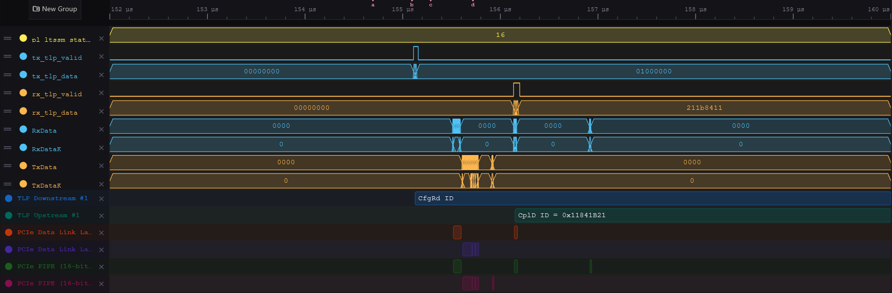
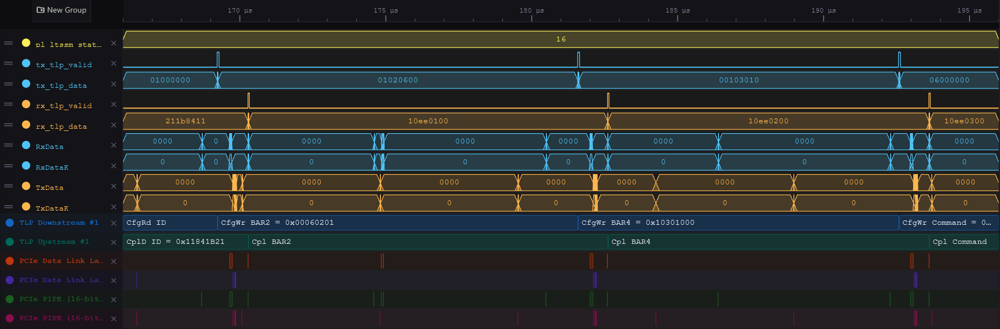
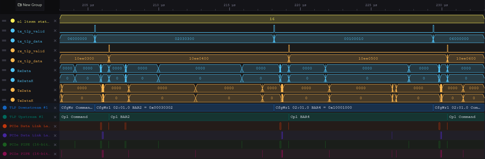
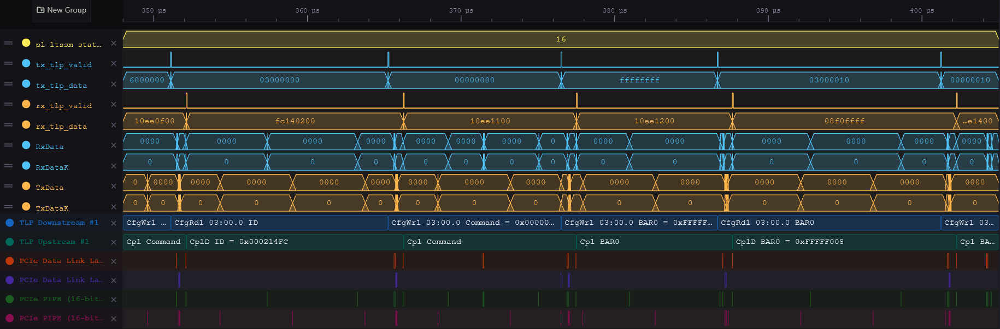
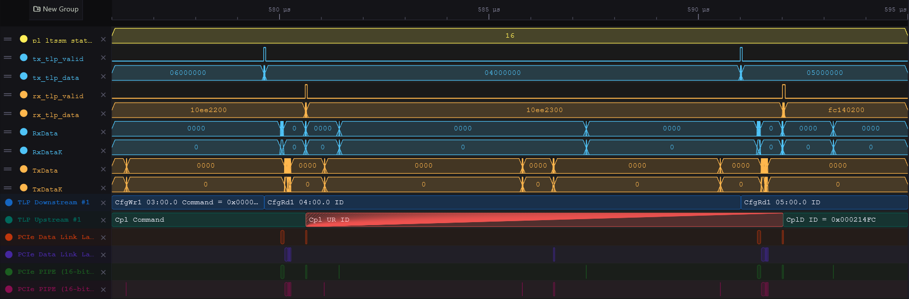
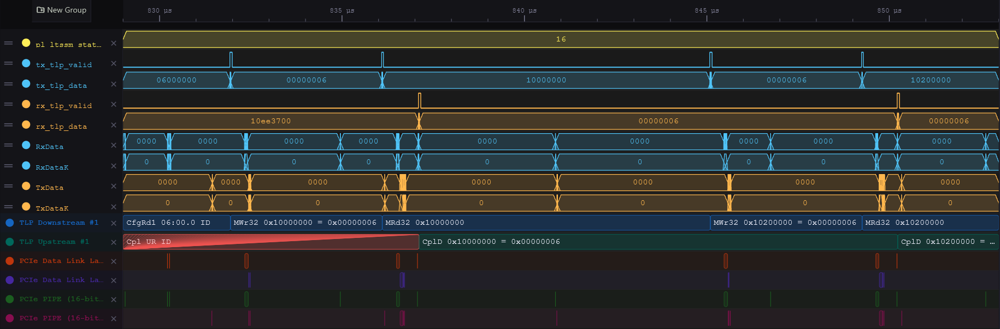
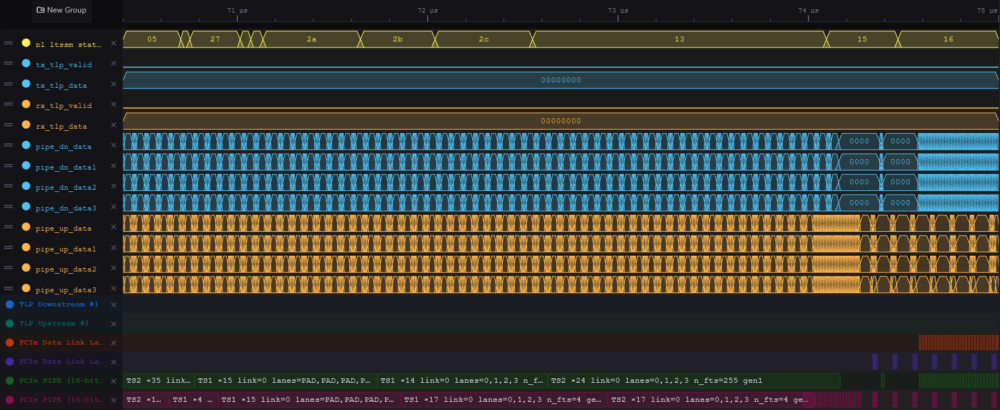
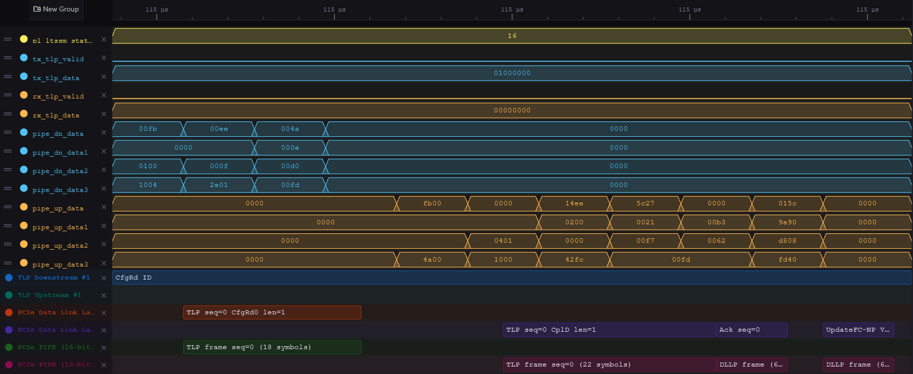

# openPCIE Simulation Top Level Test Bench

## Table of Contents

* [Introduction](#introduction)
* [Test Bench Structure](#test-bench-structure)
  * [The PIPE PHY model](#the-pipe-phy-model)
  * [Endpoint feature limitations](#endpoint-feature-limitations)
  * [Prerequisites](#prerequisites)
  * [Model and viewer versions](#model-and-viewer-versions)
  * [What the simulation does](#what-the-simulation-does)
  * [Building and running](#building-and-running)
  * [RC-switched: a switch behind the link](#rc-switched-a-switch-behind-the-link)
  * [WaveCrux decoders](#wavecrux-decoders)
  * [Viewing the TLPs in WaveCrux](#viewing-the-tlps-in-wavecrux)
  * [PCIe through a switch: a hands-on tutorial](#pcie-through-a-switch-a-hands-on-tutorial)
  * [Viewing the PIPE in WaveCrux](#viewing-the-pipe-in-wavecrux)
  * [The x4 link in WaveCrux](#the-x4-link-in-wavecrux)
  * [Every layer at the Endpoint: transaction taps](#every-layer-at-the-endpoint-transaction-taps)
  * [How long a TLP spends in the hard macro](#how-long-a-tlp-spends-in-the-hard-macro)
* [The three CPU options](#the-three-cpu-options)
  * [What they cost](#what-they-cost)
* [Auto-selection of soc_cpu Component](#auto-selection-of-soc_cpu-component)
* [_VProc_ Software](#vproc-software)
  * [Other Software Use Cases](#other-software-use-cases)
    * [Natively Compiled Application](#natively-compiled-application)
    * [RISC-V Compiled Application](#risc-v-compiled-application)
* [Building and Running Code](#building-and-running-code)
  * [Configuring ISS timing model](#configuring-iss-timing-model)
  * [Running ISS code](#running-iss-code)
    * [The openPCIE configuration](#the-openpcie-configuration)
* [PicoRV32 RTL-Only Simulation](#picorv32-rtl-only-simulation)
* [Debugging Code](#debugging-code)
  * [Natively Compiled Code](#natively-compiled-code)
  * [ISS Software](#iss-software)
* [The mem_model Co-Simulation Sparse Memory Model](#the-mem_model-co-simulation-sparse-memory-model)
* [Driving the PCIE Link](#driving-the-pcie-link)
* [Co-simulation HAL](#co-simulation-hal)
* [Our Local VIP Improvements](#our-local-vip-improvements)
* [Open-source PCIE Validation Stacks](#open-source-pcie-validation-stacks)
* [Simulation issues](#simulation-issues)
* [References](#references)


## Introduction

The *openPCIE* test bench drives the DUT's PCIE link with [*pcievhost*](https://github.com/wyvernSemi/pcievhost), a PCIE 1.1/2.0 co-simulation model written in C. It connects to the logic simulation through [*VProc*](https://github.com/wyvernSemi/vproc), a virtual processor. _VProc_ runs a program compiled natively on the host as if it were an HDL component, and that program can be the PCIE C model.

_VProc_ has a generic memory-mapped master bus for reads and writes. A Bus Functional Model (BFM) wrapper around it maps the PCIE ports into that address space, so software can drive and read them. _pcievhost_ was designed as a root complex model. A parameter turns on <ins>some</ins> endpoint features, but they are [limited](#endpoint-feature-limitations): they were built only as a target for testing the root complex model.

The diagram below is a block diagram of the top level test bench showing the main features.

<p align=center>

</p>

The DUT's PCIE link connects to _pcievhost_, configured as an endpoint, in our wrapper `PIPExN__pcieVHost.sv`: upstream's x1 PIPE wrapper `pcieVHostPipex1.v` at x1, our `pcieVHostPipexN.sv` at x4. Its user code can generate traffic, and it answers every request that needs a completion by itself. It can print the traffic of both directions to the console, configured by `ContDisps.hex`.

The user software on the virtual processor configures the model: config space registers, link initialisation, and whatever a specific Endpoint should do. Here that is [`usercode/VUserMain1.cpp`](usercode/VUserMain1.cpp). It builds a Type 0 configuration space with PCIE, MSI and Power Management capabilities, and calls `initFc()` to bring up flow control. It does not model device behaviour behind the BARs ([Endpoint feature limitations](#endpoint-feature-limitations)).

## Test Bench Structure

The test bench drives the **real** Root Complex RTL. `tb.sv` instantiates
`RC_opensource` out of `2.rtl/0.common.opensource`. That is the same top level
that goes into both bitstreams, RC-direct and RC-switched, and the whole design
comes along with it:

```
tb.sv
 |
 +- RC_opensource                                   2.rtl/0.common.opensource/src/
      |
      +- pcie_top                                real RTL
      |    +- clk_rst_gen       MMCM                  real RTL
      |    +- pcie_core                            real RTL
      |    |    `- PCIE_2_1                     Xilinx hard macro (secureip)
      |    `- phy_top    <-- REPLACED -->      5.sim/models/phy_top.PIPE.sv
      |                                                +- PIPE PHY model
      |                                                `- PIPExN__pcieVHost (endpoint,
      |                                                   VProc node 1, VUserMain1.cpp;
      |                                                   pcieVHostPipex1 / PipexN at x4)
      `- riscv_pcie_soc                             real RTL
           +- eduBOS5 (or picorv32)                 real RTL, runs firmware.hex
           `- soc_csr -> csr                        PeakRDL-generated CSR
```

Exactly **one** RTL file is swapped for the simulation, and one file is copied in:

| Item | Why |
|---|---|
| `phy_top.sv` becomes `models/phy_top.PIPE.sv` | the 7-series GTP transceiver turns PIPE symbols into a 5 GT/s serial stream. _pcievhost_ models the link at PIPE symbol level, so the transceiver has to go |
| `firmware.hex` copied into `5.sim/` | `riscv_pcie_soc.sv` reads it with `$readmemh` and a bare file name |

Everything else is what goes into the FPGA: the hard macro, the transaction
layer, the CPU, the CSR and the firmware. The swap needs no `ifdef` in the
design. The module name and port list match, so the simulation file list
(`tb.prj`) just picks the other file. The CPU swap for `CPU=vproc` /
`CPU=iss` is different: that one *is* an `` `ifdef SOC_CPU_VPROC `` in
`riscv_pcie_soc.sv` ([The three CPU options](#the-three-cpu-options)).

Three simulation-only parameters ARE set with defines. Only `5.sim/Makefile`
sets them, never a synthesis flow:

| Define | Effect | Why |
|---|---|---|
| `SIM_FAST_TRAIN` | `PL_FAST_TRAIN = "TRUE"` on the hard macro (`pcie_core.sv`) | shortens the LTSSM training timers, a simulation feature of the macro. With the real 12/24 ms timers, link training outlasts any practical run |
| `SIM_GEN1_ONLY` | `PCIE_GEN = 1` (`link_pkg.sv`) | the endpoint VIP advertises Gen1 and its LTSSM helper cannot follow a Gen1 to Gen2 retrain |
| `SIM_PIPE_CODING` | `DISABLE_SCRAMBLING = "TRUE"` on the hard macro (`pcie_core.sv`) | matches how the endpoint VIP is configured over PIPE |

### The PIPE PHY model

`models/phy_top.PIPE.sv` stands in for the transceiver, with the link partner
on its far side. It gives the `PCIE_2_1` LTSSM the three things it needs from a
PHY:

* **PHYSTATUS pulses** on exit from PIPE reset, on every power-state change and
  on every rate change
* **Receiver detection**: a PHYSTATUS pulse with `RXSTATUS = 3'b011` in answer
  to `TXDETECTRX`. That is what lets the LTSSM leave Detect
* **RXVALID / RXELECIDLE**, asserted from the first K character the partner
  sends, standing in for a squelch detector

It also makes the clocks. `TXOUTCLK` is a behavioural 100 MHz oscillator, and
everything after it is the real `clk_rst_gen` MMCM. So the design sees its normal
clock topology: PCLK at 125 MHz (Gen1) or 250 MHz (Gen2), USERCLK1/2 at 62.5 MHz
(x1) or 125 MHz (x4, Gen1).
**The 100 MHz matters.** `clk_rst_gen` is set for `CLKIN1_PERIOD = 10 ns` and
`CLKFBOUT_MULT_F = 10`. Any other input frequency scales every clock in the
design, and the PIPE then over- or under-samples the link partner. Feed it
125 MHz, and PCLK becomes 156.25 MHz and repeats one symbol in five.

Two trace options are built in, both behind defines; see
[Building and running](#building-and-running). The LTSSM state is printed on
every transition, with no define, and `tb.sv` reports `pl_phy_lnk_up`,
`core_rst_n` and `trn_link_up` as they change.

### Endpoint feature limitations

_pcievhost_ was written as a root complex model. Its endpoint side is a
parameter on top, `EndPoint = 1`, set where `models/phy_top.PIPE.sv`
instantiates the model. It trains a link and answers Configuration and Memory
requests. That is exactly what testing a root complex needs, but it is not a
device model. What you get, and what you don't:

**What it provides**

* A configuration space, built by [`usercode/VUserMain1.cpp`](usercode/VUserMain1.cpp)
  through `writeConfigSpace()` / `writeConfigSpaceMask()`: a Type 0 header
  (vendor `0x14fc`, device `0x0002`), and PCIE, MSI and Power Management
  capability structures. The mask calls make the read-only bits read-only.
* Automatic completions for Configuration and Memory requests, with Memory
  traffic landing in the
  [sparse memory model](#the-mem_model-co-simulation-sparse-memory-model).
* A full LTSSM, flow control initialisation and DLLP handling.

**What it does not**

* **No device behaviour behind the BARs.** A memory write is stored, and a read
  returns it. Nothing interprets the data: no DMA, no interrupts, no
  application logic to test against.
* **No error injection.** Malformed TLPs, completion timeouts, retries and CRS
  storms take an edit of the model, not a setting.
* **x1 upstream, x4 here.** Upstream's wrapper `pcieVHostPipex1` is x1 with a
  16-bit PIPE datapath; our `pcieVHostPipexN` runs the same model over x4
  (`make SIM_LANES=4`), Gen1 only.
* **The endpoint LTSSM paths were the least exercised part of the model.** Its
  usual job is the root complex. Three of them turned out wrong once real
  silicon drove them, instead of another copy of the same VIP. The fixes are in
  `models/pcievhost/ltssm/ltssm.c`, with the original beside it as
  `ltssm.c.orig`.

For a link partner with real device behaviour, use an RTL endpoint:
[`2.rtl/1.EP.opensource`](../2.rtl/1.EP.opensource). You lose this model's
decoded protocol log and its controllability, so the two complement each
other.

### Prerequisites

Linux or WSL, once:

- **Vivado 2026.1 for Linux** (needs a license file, even for `xsim`): `xvlog`, `xelab`, `xsim`. Windows `xsim` starts from WSL too, but it loads the C/C++ models (`-sv_lib`) only as a Windows DLL, not the Linux `.so` built here.
- **GCC 10+** (C++20) and `make`: `sudo apt install build-essential`
- **RISC-V GCC** (xPack `riscv-none-elf-`) for the firmware, see [4.build](../4.build/README.md)

Then, from the repo root:

```sh
source 4.build/set-env.sh     # tcsh: source 4.build/set-env.csh
```

It finds Vivado (`/tools/Xilinx/<version>/Vivado`, `~/Xilinx/<version>/Vivado`, or set `XILINX_VIVADO`) and the
compilers, and lists anything missing. `peakrdl` is needed only if you edit
`csr.rdl` ([4.build/README.md](../4.build/README.md#csr-hal-compilation)).

### Model and viewer versions

| Component | In use | Latest upstream (Oct 2026) | Source |
|---|---|---|---|
| VProc | 1.13.4 | 1.13.4 | [wyvernSemi/vproc](https://github.com/wyvernSemi/vproc) |
| pcievhost **(modified: DLL and TL access points besides the PIPE, x4; see below)** | 1.9.3 | 1.9.3 (without our changes) | [wyvernSemi/pcievhost](https://github.com/wyvernSemi/pcievhost) |
| mem_model **(modified, see below)** | `main` c7b9c62 (1.0.1 + one fix) | same | [wyvernSemi/mem_model](https://github.com/wyvernSemi/mem_model) |
| rv32 ISS **(modified, see below)** | 1.3.3 | 1.3.3 | [wyvernSemi/rv32](https://github.com/wyvernSemi/rv32) |
| Vivado simulator (`xsim`) | 2026.1 | 2026.1 | [AMD Vivado](https://www.amd.com/en/products/software/adaptive-socs-and-fpgas/vivado.html) |
| WaveCrux Pro | 1.1.1 | 1.1.1 | [Ferrite-Engineering/wavecrux](https://github.com/Ferrite-Engineering/wavecrux) |
| TLP decoder plugin (ours) | `wcx-pcie-tlp` pcie-tlp-v0.1.1 | pcie-tlp-v0.1.1 | [Ferrite-Engineering/wavecrux-decoders](https://github.com/Ferrite-Engineering/wavecrux-decoders/tree/main/decoders/pcie-tlp) |
| PIPE, DLL and serial-line decoder plugin | `wcx-pcie` pcie-v0.2.0 | pcie-v0.2.0 | [Ferrite-Engineering/wavecrux-decoders](https://github.com/Ferrite-Engineering/wavecrux-decoders) |
| RISC-V instruction-trace decoder | built into WaveCrux | -- | [Ferrite-Engineering/wavecrux](https://github.com/Ferrite-Engineering/wavecrux) |

#### Why XSIM and not Verilator?

Our RTL is 100% SystemVerilog, not mixed-language. It and the rest of our ecosystem are Verilator-ready. Only the vendor hard macros stand in the way, and of those only `PCIE_2_1` matters. Its simulation model is AMD's `secureip` library, encrypted (IEEE 1735). Only vendor simulators can run it, and no open model exists. The Xilinx primitives in the design:

| Primitive | Simulation model | In Verilator |
|---|---|---|
| `PCIE_2_1` | encrypted `secureip` core | no -- the blocker |
| `GTPE2_CHANNEL`, `GTPE2_COMMON` | encrypted `secureip` cores | not needed: co-sim replaces the GTP with [the PIPE PHY model](#the-pipe-phy-model) |
| `MMCME2_ADV` | plain Verilog, `real` arithmetic and `#` delays | not tried |
| `BUFG`, `BUFGCTRL`, `IBUFDS_GTE2`, `RAMB36E1`, `FDCE` | plain Verilog | expected to work |

Verilator-ready means: our RTL passes Verilator lint (`run-lint.sh`), and the co-simulation models (VProc, pcievhost, mem_model, rv32) ship with Verilator flows upstream.

A Verilator run would need `--timing` for the whole test bench, not only for the MMCM. `tb.sv` and the PIPE model make their clocks with `#` delays, and VProc waits a delta cycle for each `UpdateResponse`. VProc's `-GDISABLE_DELTA` drops that wait. It would not save `--timing` here, and it changes the handshake pcievhost runs its link on.

#### Why VCD and not FST?

XSIM writes only VCD (`$dumpfile`/`$dumpvars`) and its own `.wdb`. FST is a GTKWave format: Verilator and Icarus write it, XSIM does not. A converted copy is much smaller, and WaveCrux reads it. `make run` with `DUMP_VCD` converts it with [`tools/vcd2fst.sh`](tools/vcd2fst.sh) (GTKWave's `vcd2fst -Z`); `make fst` does only that. The FSTs are tracked (`tb.x1g1.direct.fst`: 11.6 MB VCD -> 86 KB, a 134x diet). `tb.vcd` is not.

The ready-made `.wavecrux` sessions open the tracked FSTs (`tb.x1g1.direct.fst`, `tb.x1g1.switched.fst`, `tb.x4g1.direct.fst`), named like the bitstreams, so they work from a fresh clone. They bind signals by their number in the file, and that number differs between the VCD and the FST.

#### Local changes

| File | Change | Why |
|---|---|---|
| `models/cosim/mem_model.sv` | wraps upstream `mem_model.v` (kept as `f_mem_model.v`) in Verilator `lint_off` pragmas | keeps third-party code out of our lint |
| `models/rv32/src/rv32csr_cpu.cpp` (in `rv32-openpcie.patch`) | the timer-compare check in `process_interrupts()` no longer charges cycles | it added 2 cycles to every instruction |
| `models/rv32/src/rv32i_cpu.cpp` (in `rv32-openpcie.patch`) | `sw`, `sh` add the store extra cycles | upstream adds the load ones |
| `models/rv32/usercode/rv32_timing_config.h` | PicoRV32, eduBOS5 2-/3-stage tables measured on the RTL in this SOC | see [Our Local VIP Improvements](#our-local-vip-improvements) |
| `models/rv32/usercode/VUserMain0.cpp` | no fetch/load wait states; bus credit; waits for reset release, restarts on reset; RV32I-only fetch filter | see [Our Local VIP Improvements](#our-local-vip-improvements) |
| `models/soc_cpu.VPROC.native.sv` | 2-clock picorv32 handshake; `!resetn` on VProc interrupt bit 3 | see [Our Local VIP Improvements](#our-local-vip-improvements) |

pcievhost:

| File | Change | Why |
|---|---|---|
| `ltssm/ltssm.c` | As upstream port: send Link and Lane = PAD until the partner assigns them; stay in Configuration.Lanenum for at least 16 TS1 | real PCIE_2_1 downstream port deadlocked or timed out against the model's endpoint LTSSM ([Endpoint feature limitations](#endpoint-feature-limitations)) |
| `verilog/pcieVHost/pcieVHost.v` | VProc `BE` and `Burst` ports, left open | we build VProc with `VPROC_BYTE_ENABLE` |
| `src/displink.c` (in `lib/libpcielnx.a`), `include/pcie_vhost_map.h`, `verilog/headers/pcie_vhost_map.v`, `verilog/pcieVHost/pcieVHost.v`, `pcieVHostPipex1.v` | transaction taps: TLP and DLLP ports, in [`pcievhost-taps.patch`](models/pcievhost/pcievhost-taps.patch) | the decoders need the TLPs and DLLPs; the model keeps them in C ([transaction taps](#every-layer-at-the-endpoint-transaction-taps)) |
| `verilog/headers/test_defs.v` | `` `fatal`` calls `tb.Fatal` | our test bench top is `tb` |

The unmodified `ltssm.c` is kept beside it as `ltssm.c.orig`, and our fixes as `ltssm/ltssm-openpcie.patch`. [`tools/vip-upgrade.sh`](tools/vip-upgrade.sh) rebuilds all four models from upstream and re-applies these changes. It stops if the LTSSM, the taps or the rv32 patch no longer applies. rv32 is built here from its sources (`models/rv32/src`, upstream `774d84fa`).

### What the simulation does

A full run takes the design from power-up to a verified memory transaction, with
no hardware in sight. It ends 10 µs after the firmware reports its result. `RUN_US` (default 2000) is only the time limit:

```
                   0  TB     run length 2000 us
             1000000  TB     PERST# released
             1257001  LTSSM  0xxx -> 0x00 DETECT_QUIET
             3607000  LTSSM  0x00 -> 0x02 POLLING_ACTIVE
             3847000  LTSSM  0x02 -> 0x04 POLLING_CONFIGURATION
             5079000  LTSSM  0x04 -> 0x05 CONFIG_LINKWIDTH_START
            70711000  LTSSM  0x05 -> 0x26      <- link number assigned
            71655000  LTSSM  0x2a -> 0x2b      <- lane number assigned
            72559000  LTSSM  0x2c -> 0x11      <- Configuration complete
            74103001  TB     pl_phy_lnk_up = 1  <- physical layer up
            74479000  LTSSM  0x15 -> 0x16 L0  (linkup)
            75287001  TB     trn_link_up   = 1  <- data link layer up, flow control done
            75287001  TB     ===> PCIe LINK UP -- SOC released from reset
            75303000  TB     core_rst_n   = 1  <- core reset released (TRN, SOC)
           389575000  TB     ===> FIRMWARE RESULT 0x0000face  (PASS)
           399575000  TB     *** run ends 10 us after the firmware result ***
--------------------------------------------------------
 openpcie2-rc co-simulation summary
--------------------------------------------------------
  PCIe link up ............ YES
  LTSSM final state ....... 0x16
  TLPs sent by firmware ... 21
  Payload written to EP ... 0x00000006  (Memory Write TLP)
  Payload read back ....... 0x00000006  (match)
  FIRMWARE RESULT ......... PASS (0x0000face)
--------------------------------------------------------
```

The last three lines of the summary are the real result. `0x0000FACE` is only
the verdict the firmware reports. The two lines above it are the dword that
really crossed the link: written to the endpoint at `0x8000_0000` by a Memory
Write TLP, then fetched back by a Memory Read and its completion. The firmware
says PASS; the wire proves it.

In between, the real firmware enumerates the endpoint model exactly as it does
on the board. The endpoint's own decode of the traffic:

```
RC -> EP   Config read  type 0  Reg=00   ID                    TAG=00
EP -> RC   Completion with data              Device 0002, Vendor 14FC
RC -> EP   Config write type 0  Reg=01   Command = 0           memory decode off
RC -> EP   Config write type 0  Reg=04   BAR0 = 0xFFFFFFFF     size it ...
RC -> EP   Config read  type 0  Reg=04   BAR0
EP -> RC   Completion with data              0xFFFFF008            4 KB, 32-bit, prefetchable
RC -> EP   Config write type 0  Reg=04   BAR0 = 0x80000000     ... and place it
           ... the same for BAR1 (1 KB -> 0x80001000), BAR2/3 (64-bit, 8 GB:
           parked above 4 GB), BAR4/5 (read back 0: not implemented) ...
RC -> EP   Config write type 0  Reg=01   Command = 6           memory space + bus master
RC -> EP   Mem write req  Addr=80000000  data 0x00000006
RC -> EP   Mem read  req  Addr=80000000  TAG=14
EP -> RC   Completion with data              0x00000006            TAG=14
```

Every request goes through the same completion check. The firmware reads the
Completion Status of each one, and re-issues a request answered with CRS. All 21
TLPs are enumeration and test. The result marker goes to `status.result`, which
sends no TLP.

The same traffic, decoded at TLP level in a waveform viewer:
[Viewing the TLPs in WaveCrux](#viewing-the-tlps-in-wavecrux).

And the CSR side of the same sequence, as the firmware sees it:

```
CSR RD [0x20] = 0000001e     status.phy -- Tx FSM idle, 30 buffers free
CSR WR [0x00] = 04000001     tx.header0 -- CfgRd0, length 1
CSR WR [0x04] = 10ee000f     tx.header1 -- requester 0x10EE, tag 0, BE 0xF
CSR WR [0x08] = 01000000     tx.header2 -- bus 1, device 0, function 0, register 0
CSR WR [0x0c] = 00000000     tx.data    -- the write strobe starts the transfer
CSR RD [0x18] = ...          rx.header_info -- polled until the completion lands
...
CSR WR [0x24] = 0000face     status.result -- the pass marker, sends no TLP
```

### Building and running

Set up the [Prerequisites](#prerequisites) first, including `set-env`.

```
cd 5.sim
make                                # firmware + VProc.so + xvlog + xelab
make run                            # -> the summary above
make gui                            # same, with waveforms
```

`make` builds the firmware itself, every time, into `obj/fw`, with `SIM=1`. Why: `main()` opens with `wait_cycles(100000)`, to wait for the link to train. On hardware that costs nothing. In simulation it is tens of milliseconds of simulated time with the firmware twiddling its thumbs. `SIM=1` cuts it to 200 iterations, and the whole run fits in about 0.4 ms (0.7 ms with `CORE=picorv32`). The tracked `4.build/sw_build/firmware.hex` stays the board build; no simulation touches it. `VARIANT=switched` builds the RC-switched firmware instead and puts a switch behind the link ([below](#rc-switched-a-switch-behind-the-link); step by step in [the tutorial](#pcie-through-a-switch-a-hands-on-tutorial)).

Useful switches:

```
make run RUN_US=10000                        # higher time limit; read at time 0 from run_us.cfg
make USRSIMOPTS="--define CPU_TRACE"         # CPU bus activity and every CSR access
make USRSIMOPTS="--define PIPE_OS_TRACE"     # ordered sets both ways, with link/lane numbers
make USRSIMOPTS="--define PIPE_RAW_DUMP"     # raw PIPE symbols
```

The LTSSM state, the link status bits and the firmware's result marker are
always printed, with no define.

### RC-switched: a switch behind the link

`make run VARIANT=switched` runs the RC-switched firmware ([`3.sw/RC-switched/main.c`](../3.sw/RC-switched/main.c)) on the same RTL. pcieVHost stays the link partner, and [`usercode/pcie_switch.cpp`](usercode/pcie_switch.cpp) answers its requests as a switch with endpoints behind it:

| Bus | Device | Answers |
|---|---|---|
| 1 | 0 | the switch upstream port (Type 0) |
| 2 | 1, 3, 5, 7 | the four downstream ports, as on the ASM1184e |
| 3, 5 | 0 | an endpoint on ports 1 and 3, with the RC-direct endpoint's IDs, class and BAR0-3 |
| 4, 6 | 0 | nobody: ports 2 and 4 are empty slots and answer Unsupported Request |

Routing follows what the firmware programs, as in hardware: Type 1 by the bus numbers, memory by the base/limit windows and Memory Space Enable, endpoint memory by BAR0 and BAR1. Each endpoint has its own memory, so a request routed to the wrong slot fails the readback. The model prints what it routes:

```
pcie_switch: CfgRd1 bus 4 dev 0 reg 0x000: Unsupported Request
pcie_switch: CfgRd1 bus 6 dev 0 reg 0x000: Unsupported Request
pcie_switch: MWr 0x10000000 -> endpoint on port 1
pcie_switch: MRd 0x10000000 <- endpoint on port 1
pcie_switch: MWr 0x10200000 -> endpoint on port 3
pcie_switch: MRd 0x10200000 <- endpoint on port 3
  FIRMWARE RESULT ......... PASS (0x0000face)
```

With eduBOS5 the run ends at 0.86 ms of simulated time, in about 3 minutes. x1 only, as the board.

### WaveCrux decoders

Three sets of decoders, one per layer. They complement each other:

| Decoders | Show | Where |
|---|---|---|
| Ferrite's PIPE, Data Link Layer and serial-line decoders (free) | ordered sets, DLLPs, Ack/Nak, flow control, LCRC, TLP framing | [wavecrux-decoders `decoders/pcie`](https://github.com/Ferrite-Engineering/wavecrux-decoders/tree/main/decoders/pcie) |
| Our TLP decoder (free), contributed to Ferrite's wavecrux-decoders | every TLP named, each completion paired with its request | [wavecrux-decoders `decoders/pcie-tlp`](https://github.com/Ferrite-Engineering/wavecrux-decoders/tree/main/decoders/pcie-tlp) |
| WaveCrux Pro PCIe TLP analysis | latency, timeouts, Base Spec rule checks, bus statistics | [WaveCrux docs](https://github.com/Ferrite-Engineering/wavecrux/blob/main/docs-site/docs/protocol-decoders.md#pcie-tlp-analysis) |

Setting them up on this test bench: [TLPs](#viewing-the-tlps-in-wavecrux) and [PIPE](#viewing-the-pipe-in-wavecrux) below.

### Viewing the TLPs in WaveCrux

All pictures in this section, [the PIPE section](#viewing-the-pipe-in-wavecrux) and [the x4 section](#the-x4-link-in-wavecrux) are from the **RC-direct** run: the Root Complex talks straight to one Endpoint, with no switch in between.

XSIM's own waveform database is the `.wdb` that `make gui` opens. For a view at
*TLP level*, with every packet named and every completion paired with its
request, the run can also write a VCD for [WaveCrux](https://wavecrux.app). A
decoder plugin and a ready-made session do the rest:

```
make run USRSIMOPTS="--define DUMP_VCD --define DUMP_SOC_CPU"   # -> 5.sim/tb.vcd (not tracked) + tb.x1g1.direct.fst (tracked)
```

The tracked `tb.x1g1.direct.fst` comes from this command. `DUMP_SOC_CPU` adds the CPU's RVFI trace for [`tb.x1g1.direct.RISCV-ISA.wavecrux`](tb.x1g1.direct.RISCV-ISA.wavecrux). Leave it out, and that session comes up empty.

Then, once per machine:
1. Get the TLP decoder from its [release page](https://github.com/Ferrite-Engineering/wavecrux-decoders/releases/tag/pcie-tlp-v0.1.1) (Windows: `wcx-pcie-tlp-0.1.1-windows-x64.zip`; check it against `SHA256SUMS`). Unzip it to a folder of its own.
2. In WaveCrux (1.0.1 or later): **Settings -> Extensions -> Decoder Plugins**, accept the safety notice, **Add directory...** that folder, **Reload plugins**.
3. Add Ferrite's PIPE and Data Link Layer plugin the same way ([Viewing the PIPE in WaveCrux](#viewing-the-pipe-in-wavecrux)).

Then open [`tb.x1g1.direct.TLP-DLL-PIPE.wavecrux`](tb.x1g1.direct.TLP-DLL-PIPE.wavecrux) (File -> Open, or `wavecrux_pro tb.x1g1.direct.TLP-DLL-PIPE.wavecrux`). It loads `tb.x1g1.direct.fst` from the same directory, with all decoders bound. The decoder's source, signals and parameters: [wavecrux-decoders `decoders/pcie-tlp`](https://github.com/Ferrite-Engineering/wavecrux-decoders/tree/main/decoders/pcie-tlp).

In each picture, the TLP decoder rows are the TLP stream in either direction.
**TLP Downstream** is Root Complex -> Endpoint (`tx_`), **TLP Upstream** is
Endpoint -> Root Complex (`rx_`). The raw streams they decode are the `tx_`/`rx_` signal rows, one DW per clock. The rows below them: [Viewing the PIPE in WaveCrux](#viewing-the-pipe-in-wavecrux).

At this zoom the Data Link Layer and PIPE rows show only thin ticks. Besides each TLP's own frame and Ack, they are:
- SKP ordered sets: the Root Complex sends one every 5.9 µs, the Endpoint every 4.7 µs (1474 and 1180 symbol times). Each receiver uses them to make up for the clock difference between the two ends.
- UpdateFC DLLPs: each side re-sends its posted credits about every 30 µs, unchanged, even with no posted TLP in flight.

**BAR0 sizing.** The firmware writes all ones to BAR0 and reads it back:
`0xFFFFF008`, a 4 KB, 32-bit, prefetchable BAR. Then it places it at `0x80000000`:

<p align="center">

</p>

**A 64-bit BAR that does not fit.** BAR2 has already read back `0x0000000C`
(64-bit, prefetchable). The upper half, BAR3, reads back `0xFFFFFFFE`: 8 GB.
That cannot fit below 4 GB, and this Root Complex sends only 32-bit addresses.
So the firmware parks it at `0x2_0000_0000` instead of squeezing it in. 8 GB
into a 4 GB suitcase does not go:

<p align="center">

</p>

**The self-test.** Memory Space and Bus Master enabled. Then a posted Memory
Write of `6` to `0x80000000`, and a Memory Read whose completion brings the same
`6` back: the `PASS (0x0000face)` of the summary above. Note what is missing: the Memory Write has no completion. It is *posted*. The Root Complex sends it and moves on, fire and forget, which is what makes writes cheap. Reads and Configuration requests are *non-posted*, and each waits for its completion:

<p align="center">

</p>

The firmware then writes `PASS` to `status.result`. That register sends nothing, so this read is the last TLP of the run. Writing `tx.data` launches a TLP, which is why the result has a register of its own.

**The firmware sets the pace.** A Configuration request and its Completion take about 1 µs ([How long a TLP spends in the hard macro](#how-long-a-tlp-spends-in-the-hard-macro)). Yet the requests leave about 10 µs apart. The link spends most of its life waiting for the SOC's next request.

What makes this possible in the test bench:

* [`models/tlp_dw_monitor.sv`](models/tlp_dw_monitor.sv) re-times the SOC's
  64-bit AXI-Stream into one DW per clock with SOP/EOP flags, onto a
  [`tlp_dw_if`](models/tlp_dw_if.sv). One instance per direction.
* [`models/tlp_wavecrux_view.sv`](models/tlp_wavecrux_view.sv) presents both
  directions as `tb.tlp_view.tx_*` and `rx_*`, named after the decoder's
  inputs. So WaveCrux's auto-bind finds them, and its prefix drop-down picks
  `tx_` or `rx_`.

The session stores the decoder bindings as positions in the FST. They are the
same for every run of this test bench. If another simulator version orders the
dump differently, or a change to `tb.sv` dumps other signals, the decoder rows
come up empty. Then rebind the session to the new dump:
`python3 tools/wavecrux-rebind.py tb.x1g1.direct.TLP-DLL-PIPE.wavecrux tb.x1g1.direct.fst <old FST>`
(needs `fst2vcd`, from GTKWave). Or remove the rows and add them again with
**Ctrl+Shift+D**: auto-bind fills in all nine inputs.

### PCIe through a switch: a hands-on tutorial

The RC-direct pictures above show one Root Complex and one Endpoint. Most real systems have a switch in between. This section walks the [RC-switched run](#rc-switched-a-switch-behind-the-link) step by step: what the firmware asks, what the switch answers, and the PCIe rule behind each answer.

```
make run VARIANT=switched USRSIMOPTS="--define DUMP_VCD --define DUMP_SOC_CPU"   # -> tb.x1g1.switched.fst
```

Then open [`tb.x1g1.switched.TLP-DLL-PIPE.wavecrux`](tb.x1g1.switched.TLP-DLL-PIPE.wavecrux), with the same decoders as above.

**The picture to keep in mind.** To software, a switch is not one device. It is a set of PCI-to-PCI bridges: an upstream port facing the Root Complex, one downstream port per slot, and an internal bus that joins them. Each bridge has a Type 1 configuration header with three bus numbers (primary, secondary, subordinate) and a memory window (base, limit). Enumerating a switch means filling these in:

```
RC -- bus 1 -- upstream port -- bus 2 (internal) --+-- dev 1: port 1 -- bus 3 -- endpoint
                                                   +-- dev 3: port 2 -- bus 4 -- (empty slot)
                                                   +-- dev 5: port 3 -- bus 5 -- endpoint
                                                   +-- dev 7: port 4 -- bus 6 -- (empty slot)
```

The switch is a model ([`usercode/pcie_switch.cpp`](usercode/pcie_switch.cpp)). The waveforms show the one real link: what the Root Complex sends and what a switch must answer.

**1. Who is there?** The first request is the same as in RC-direct: a Type 0 Configuration Read of register 0, at bus 1, device 0. The answer is not an Endpoint's ID. It is `0x11841B21`: vendor `0x1B21` (ASMedia), device `0x1184`, the switch. Type 0 means "the device at the other end of this link", and here that is the switch's upstream port:

<p align="center">

</p>

**2. The upstream port gets its bus numbers and its window.** Register `0x18` = `0x00060201`: primary bus 1 (towards the Root Complex), secondary bus 2 (the internal bus), subordinate bus 6 (the highest bus behind it). Register `0x20` = `0x10301000`: memory base `0x1000_0000`, limit `0x103F_FFFF`, in 1 MB steps. Then Command = `0x0006`: Memory Space and Bus Master on. From now on the port forwards Type 1 requests for buses 2 to 6 and memory requests inside its window, and nothing else.

The decoder names registers by the Endpoint (Type 0) layout. In a bridge header, `0x18` is Bus Numbers, not BAR2, and `0x20` is Memory Base/Limit, not BAR4:

<p align="center">

</p>

**3. Type 1: talking past the first bridge.** The downstream ports sit on bus 2, one bus beyond the link. The firmware sends the same Configuration Write as before, but the Root Complex sends it as Type 1 (`CfgWr1 02:01.0`), because the bus number is not 1 ([`riscv_pcie_soc.sv`](../2.rtl/0.common.opensource/src/riscv_pcie_soc.sv) picks the type from the bus number). The upstream port sees that bus 2 is its own secondary bus, and passes the request on as Type 0. Port 1 (device 1) gets bus 3 and the first 1 MB of the window, `0x1000_0000`. The Completer ID says who answered: `0x0208` = bus 2, device 1. Ports 2 to 4 follow the same way:

<p align="center">

</p>

**4. The Endpoint behind port 1.** Bus 3 is port 1's secondary bus. The request crosses two bridges and becomes Type 0 at the last one. The Endpoint answers `0x000214FC`, and BAR0 sizing works exactly as in RC-direct: write all ones, read back `0xFFFFF008` (4 KB), then place it at `0x1000_0000`, the base of port 1's window. A BAR outside its port's window could never be reached, as the bridge would not forward requests to it:

<p align="center">

</p>

**5. An empty slot.** Bus 4 belongs to port 2, which has no card. Port 2 answers the read itself, with Unsupported Request, in red (Completer ID `0x0218`: bus 2, device 3). The firmware takes UR as "no device" and moves on to bus 5, where the second Endpoint answers:

<p align="center">

</p>

**6. Memory goes by address, not by bus number.** A Memory request carries no bus number. The switch routes it by the windows of steps 2 and 3: `0x1000_0000` is in port 1's window and reaches the Endpoint on bus 3; `0x1020_0000` is in port 3's window and reaches bus 5. Each Memory Write is posted (no completion), and each Memory Read brings back the `6` just written, from its own Endpoint:

<p align="center">

</p>

**Try it yourself:**
- Fill slot 2: set `port_has_ep` in [`usercode/pcie_switch.cpp`](usercode/pcie_switch.cpp) to `{true, true, true, false}`. The firmware finds three Endpoints, and bus 4 now answers.
- Empty all four slots (`{false, false, false, false}`). The switch is still found, and the run ends with `0xBAD00001`: switch up, no Endpoint behind it.
- Leave out the `bridge_set_window()` call for the downstream ports in [`3.sw/RC-switched/main.c`](../3.sw/RC-switched/main.c). Enumeration still passes, as it uses bus numbers only. The memory test should then fail with `0x0000DEAD`: with no window, the switch has no route for the address.

### Viewing the PIPE in WaveCrux

The same dump also carries the 16-bit PIPE between the Root Complex's
PCIE_2_1 hard macro and the pcieVHost endpoint, one level below the TLPs:
the symbols as they go on the wire, before 8b/10b. All signals are under
`tb.dut.u_pcie.u_phy_top.u_pcie_ep`:

| Signal | Direction |
|---|---|
| `pclk` | PIPE clock, one 16-bit word (two symbols) per rising edge |
| `RxData` / `RxDataK` | Root Complex -> Endpoint |
| `TxData` / `TxDataK` | Endpoint -> Root Complex |

These are the inputs of Ferrite's
[PCIe PIPE and Data Link Layer decoders](https://github.com/Ferrite-Engineering/wavecrux-decoders)
(Apache-2.0). Get the plugin from their
[release page](https://github.com/Ferrite-Engineering/wavecrux-decoders/releases/tag/pcie-v0.2.0)
(Windows: `wcx-pcie-0.2.0-windows-x64.zip`; check it against `SHA256SUMS`). Unzip it to a folder of its own, and add
that folder under **Settings -> Extensions -> Decoder Plugins**, as above. Then open
[`tb.x1g1.direct.TLP-DLL-PIPE.wavecrux`](tb.x1g1.direct.TLP-DLL-PIPE.wavecrux) (File -> Open, or
`wavecrux_pro tb.x1g1.direct.TLP-DLL-PIPE.wavecrux`). It loads `tb.x1g1.direct.fst` from the same directory, with the TLP and PIPE rows and all six decoders bound, at the first TLP (a CfgRd0 at 155 µs).

To set it up by hand instead:
- Add **PCIe PIPE (16-bit)** and **PCIe Data Link Layer (16-bit)** with **Ctrl+Shift+D**, once per direction: prefix `Rx`, then `Tx`, each time **Apply confirmed only**.
- Take the 16-bit variants. Each decoder comes in 8, 16, 32 and 64 bits, and only the one matching the bus binds.
- Leave `scrambling` at `auto`. The simulation link runs unscrambled, and the decoder locks to that by itself.
- Optionally bind `u_phy_top.rx_active` to `rxvalid` by hand on the `Tx` instances. It gates what the Root Complex receives.

In the pictures, the rows follow the protocol stack from top to bottom. The signal rows: the LTSSM state, the TLP view (`tx_`/`rx_`), then the PIPE, `RxData`/`RxDataK` in blue (Root Complex -> Endpoint) and `TxData`/`TxDataK` in orange (Endpoint -> Root Complex). Below them, the decoder rows in the same order: TLP Downstream and Upstream, Data Link Layer `Rx` and `Tx`, PIPE `Rx` and `Tx`.

The link comes up from the bottom of that stack. First only the PIPE carries anything: the training ordered sets. Then the PIPE and the Data Link Layer: the flow-control DLLPs. Only then do TLPs flow. That is why the TLP rows stay empty in the first two pictures, and the Data Link Layer rows in the first one.

**Link training.** Both sides have been sending TS2s with PAD for link and lane
number (Polling). Now in Configuration, the Root Complex proposes link 0 in
TS1s (`link=0 lane=PAD`), and the Endpoint echoes it. Then lane 0 is proposed
and echoed (`link=0 lane=0`). TS2s with both numbers close Configuration. Each
side also advertises how many FTS ordered sets it needs to leave L0s: 255 for
the Root Complex, 4 for the Endpoint. The Data Link Layer rows stay empty: no
DLLP goes out before the link is up. The Root Complex's LTSSM reaches L0 at
74.5 µs, just after this view:

<p align="center">

</p>

**Flow-control initialisation.** As soon as the link is up, each side advertises its
receive buffer credits, in header (`H`) and data (`D`) units, for Posted (`P`),
Non-Posted (`NP`) and Completion (`Cpl`) traffic. First in InitFC1 DLLPs, then
in InitFC2 to confirm. No TLP can go until this is done. Each side repeats its set of three InitFC1s until it has the other side's. The Endpoint sends four rounds, because the Root Complex starts 0.2 µs later. This 115 ns view catches the two sides one step apart:
- The Endpoint is already sending InitFC2 (Data Link Layer `Tx` row): 32 posted headers with
  1008 data credits, and 32 non-posted headers.
- The Root Complex is still sending InitFC1 (Data Link Layer `Rx` row): 32 posted headers
  with 437 data credits.

A data credit is 16 bytes (4 DW). The Endpoint has room for 16 KB of posted data, the Root Complex for 7 KB. For non-posted requests, the Root Complex grants 12 headers (in its InitFC1-NP, outside this view), the Endpoint 32.

`H=0 D=0` means infinite, not zero: both ends advertise infinite Completion
credits. The spec requires that of an Endpoint, and of a Root Complex without
peer-to-peer traffic between its ports. On the PIPE, each DLLP is framed SDP
(`5c`) ... END (`fd`), both K symbols:

<p align="center">

</p>

**The first TLP on the wire.** At 155.1 µs the firmware's first Configuration
Read leaves the Root Complex as `TLP seq=0 CfgRd0`, framed STP ... END. The
Endpoint answers with its Completion, `TLP seq=0 CplD`. Seq 0 again, because
each direction numbers its own TLPs. It then sends `Ack seq=0` for the
Configuration Read, so the Root Complex can drop it from its replay buffer. And
`UpdateFC-NP`, to return the non-posted credit the read used.

The Root Complex acknowledges the Completion in turn, with its own `Ack seq=0`
at 155.73 µs, just outside this view. It takes 0.44 µs; the Endpoint model acknowledged the read after 0.13 µs. An Ack does not have to be immediate. `Ack seq=N` acknowledges every TLP up to N, so a receiver may wait and acknowledge several at once. In this run the TLPs are too far apart for that, and each one gets its own Ack.

<p align="center">

</p>

**Why `UpdateFC-NP` says `H=33`, not `H=1`.** An UpdateFC does not say "here is one more credit". It carries the running total of credits granted since flow-control initialisation: the 32 of InitFC, plus the 1 the read just returned. Follow it through the run, and it counts up by one header per non-posted TLP: 34, 35, 36, ... Its data credits go up only after a Configuration Write, which carries a DW of data. After a Configuration Read they stay put.

Why a total and not a delta? DLLPs are never acknowledged or replayed, so one can get lost on the wire. With a delta, a lost credit would be gone for good, like a sock in the dryer, and the link would slowly run dry. With a total, the next UpdateFC repairs it. The same reason explains the UpdateFCs that repeat every 30 µs with unchanged values ([Viewing the TLPs](#viewing-the-tlps-in-wavecrux)): a regular refresh, so a lost one never stalls the link.

**The Data Link Layer: its traffic is shown, its internals are not.** On this
Root Complex, the Data Link Layer lives inside the 7-series PCIE_2_1 hard macro.
Nothing inside it reaches the VCD. What happens in the macro stays in the macro:

* the replay buffer, which holds each TLP until it is acknowledged
* the sequence counters (next to send, next expected)
* the Ack/Nak latency and replay timers
* the flow-control credit counters

What the Data Link Layer *puts on the wire* does reach the VCD, because it
crosses the PIPE. Ferrite's Data Link Layer decoder (`ferrite.pcie_dll_w16`)
reads that. From the PIPE symbols alone, it names:

* every DLLP: `Ack seq=0`, `Nak`, `InitFC1-P` / `InitFC2-NP` / `UpdateFC-Cpl`
  with their header and data credits, and the PM DLLPs, each with its CRC-16
  checked
* every TLP with its sequence number and LCRC check, the TLP type (`CfgRd0`,
  `CplD`, `MWr32`, ...), Length, TC, TD and EP
* replays, sequence-number errors and nullified TLPs

So the pictures above show the Data Link Layer protocol between the two ends:
which TLP got which sequence number, when it was acknowledged, and how many
credits each side granted. They do not show how the hard macro reached those
decisions. For that, take an open-source Data Link Layer in RTL, where every
internal signal can be dumped: the sibling project's
[openCologne-PCIE `2.rtl/4.dll`](https://github.com/chili-chips-ba/openCologne-PCIE/tree/main/2.rtl/4.dll).
Its wave snapshots are coming soon.

**A clean bill of health.** Across the whole run, the wire shows no sign of trouble. Each check below is one you can run on any PCIE dump:
- **No replay.** The Root Complex sent 21 TLPs, seq 0 to 20, and the Endpoint 20, seq 0 to 19: no gap and no repeat, so no TLP had to be sent twice.
- **No error.** No Nak, and no TLP ended in EDB (a nullified TLP): every frame passed its CRC check.
- **Nothing left unacknowledged.** Every TLP in both directions got its Ack.
- **Every request answered.** 21 requests, one of them the posted Memory Write: 20 completions came back, exactly one per non-posted request.

### The x4 link in WaveCrux

`make run SIM_LANES=4 USRSIMOPTS="--define DUMP_VCD"` runs the same firmware over an x4 Gen1 link. The tracked dump is `tb.x4g1.direct.fst`, and [`tb.x4g1.direct.PIPE-DLL.wavecrux`](tb.x4g1.direct.PIPE-DLL.wavecrux) opens it with all four lanes in each direction. Decoding them needs Ferrite's multi-lane PIPE and Data Link Layer decoders, [wavecrux-decoders PR #18](https://github.com/Ferrite-Engineering/wavecrux-decoders/pull/18) (not released yet).

**Training on four lanes.** Configuration numbers the lanes: TS1 `link=0 lanes=PAD,PAD,PAD,PAD`, then `lanes=0,1,2,3`, then TS2 with both numbers. The decoder deskews the lanes on these ordered sets and reports `Link width x4` and `Lanes aligned x4 (offsets 0,0,0,0)` at 73.97 µs. In each direction, the four lanes switch from training to data together, and the LTSSM reaches L0 (`16`) at 74.5 µs:

<p align="center">

</p>

**The first TLP, striped.** The firmware's first Configuration Read leaves at 114.6 µs, earlier than at x1 because the SOC runs on the 125 MHz `user_clk`. Its 18 symbols are spread over the four lanes, starting with STP (`fb`) on lane 0, so they take 3 PIPE clocks instead of 9. The Endpoint answers with `CplD` (22 symbols), `Ack seq=0` and `UpdateFC-NP`, as at x1:

<p align="center">

</p>

### Every layer at the Endpoint: transaction taps

The PIPE shows the link as symbols. The Endpoint model also reports each TLP and DLLP it sends and receives, through transaction taps we added to pcieVHost. Our wrapper [`models/PIPExN__pcieVHost.sv`](models/PIPExN__pcieVHost.sv) puts them on one decoder page, `tb.dut.u_pcie.u_phy_top.u_pcie_ep`, next to its PIPE link, under the names WaveCrux auto-binds (dn = RC -> EP, up = EP -> RC):

| Layer | Signals | For |
|---|---|---|
| PIPE | `pipe_dn_*`, `pipe_up_*` (`pclk`, `data`, `datak`) | the PIPE and Data Link Layer decoders |
| Data Link | `dllp_dn_*`, `dllp_up_*`: every DLLP, one word each | DLLP rows |
| Data Link | `dll_rx_*`: RC -> EP TLPs and DLLPs, as an Endpoint's DLL hands them to its TL | driving a TL under test |
| Transaction | `tx_*` (RC -> EP), `rx_*` (EP -> RC) | the TLP decoder |

So the dump now has two TLP views, one at each end of the link: `tb.tlp_view` at the Root Complex's AXI-Stream, `u_pcie_ep` at the Endpoint. Same TLPs (21 down, 20 up), the hard macro and the link apart. The run also shows 67 DLLPs down and 92 up.

The C side is [`models/pcievhost/pcievhost-taps.patch`](models/pcievhost/pcievhost-taps.patch), applied by [`tools/vip-upgrade.sh`](tools/vip-upgrade.sh). The wrapper is the one [openCologne-PCIE](https://github.com/chili-chips-ba/openCologne-PCIE/tree/main/5.sim#transaction-taps-a-test-platform-at-every-layer) uses for its host and its mock Endpoint; [how it works](https://github.com/chili-chips-ba/openCologne-PCIE/blob/main/0.doc/5.sim/pcievhost-taps.drawio.png).

### How long a TLP spends in the hard macro

With all three layers in one view, you can follow a single request through the
Root Complex, and time how long the PCIE_2_1 hard macro takes to pass it on.
Open [`tb.x1g1.direct.TLP-DLL-PIPE.wavecrux`](tb.x1g1.direct.TLP-DLL-PIPE.wavecrux) (it needs both
plugins). The TLP view of the SOC's AXI-Stream is at the top, the PIPE below
it, and the TLP, PIPE and Data Link Layer decoders at the bottom.

Here is the firmware's first Configuration Read and its Completion. The markers
on the time axis show where the TLP crosses from one layer to the next:

<p align="center">

</p>

| Marker | What happens |
|---|---|
| **a** | The CPU's request leaves the SOC on the AXI-Stream |
| **b** | About 0.4 µs later, it appears on the PIPE, on its way to the Endpoint |
| **c** | The Endpoint's Completion has fully arrived on the PIPE |
| **d** | About 0.4 µs later, the Completion reaches the SOC |

The Endpoint model answers almost at once. So nearly all of the 1 µs round trip
is spent inside the hard macro, about 0.4 µs each way. On the way back, the
clock starts only once the whole TLP has arrived (marker **c**). The hard macro
holds each TLP until its LCRC checks out, and only then hands it to the SOC.

The same holds for every TLP in the run, give or take one clock. Two things to
keep in mind when comparing with real hardware:

* The simulation link runs at Gen1 (`SIM_GEN1_ONLY` above). At Gen2 the link
  itself is twice as fast.
* The PIPE PHY model is ideal. On the board, the GTP transceiver adds its own
  latency on both sides of the link.


## The three CPU options

The SOC's CPU socket takes three different tenants, picked with `CPU=` on the make command line. The rest of the DUT is the same in all three: the same CSR, the same PCIE stack, the same top level. So the same test runs each time; only the thing issuing the bus accesses changes. `CORE=` picks the RISC-V core: [`edubos5`](../2.rtl/0.common.opensource/src/CPU.eduBOS5) (default, 2-stage), `edubos5_3stg` or `picorv32`.

| `CPU=` | What sits on VProc node 0 | Executes |
|---|---|---|
| `rtl` (default) | nothing -- the real RTL core: `CORE=edubos5` (default), `edubos5_3stg` or `picorv32` | `firmware.hex`, the same image that goes into the bitstream |
| `vproc` | VProc | the same firmware (`3.sw/common/pcie.c`, `3.sw/RC-<VARIANT>/main.c`), compiled for the host; [`usercode/VUserMain0.cpp`](usercode/VUserMain0.cpp) calls its `main` |
| `iss` | VProc + the [rv32](models/rv32) instruction set simulator, with `CORE`'s timing model | `firmware.elf`, interpreted -- real RISC-V instructions, no RTL core |

```sh
make run                               # CPU=rtl CORE=edubos5, the default
make run CORE=picorv32
make run CPU=vproc
make run CPU=iss                       # -V EDUBOS5STG2 (CORE=edubos5, the default)
make run CPU=iss CORE=picorv32         # -V PICORV32
```

The swap happens in [`riscv_pcie_soc.sv`](../2.rtl/0.common.opensource/src/riscv_pcie_soc.sv). eduBOS5 is the default, and `` `ifdef SOC_CPU_PICORV32 `` selects PicoRV32. `` `ifdef SOC_CPU_VPROC `` selects the module for the two VProc builds, [`models/soc_cpu.VPROC.native.sv`](models/soc_cpu.VPROC.native.sv): VProc as the CPU, on the SOC's *native* memory bus (picorv32's `mem_valid`/`mem_ready` bus, which eduBOS5 drives too).

> Not to be confused with the inherited `models/soc_cpu.VPROC.sv`, kept for reference. That one speaks the `soc_if` bus of the sibling Chili.CHIPS SOC infrastructure. This design has no `soc_if`: it instantiates the core directly, so it needed its own wrapper.

So all three run one firmware source. With `CPU=vproc`, the firmware's register accesses (`CSR_REG32` in [`csr_regs.h`](../4.build/csr_build/csr_regs.h)) become VProc bus cycles, each followed by 8 idle SOC cycles (`CSR_VP_GAP`), about what a core spends between two accesses. The register offsets come from the same [`csr.rdl`](../4.build/csr_build/csr.rdl) that produces the register RTL, so hardware, firmware and the co-simulation cannot drift apart. The ISS is configured in [`vusermain.cfg`](vusermain.cfg). There, `-x`/`-X` put the CSR window on the simulated bus, and leave code and data in the ISS's own memory. The make file copies it to `iss.cfg`, with `-V` set from `CORE`.

### What they cost

Vivado XSIM 2026.1, x1 Gen1 runs, simulated time, which is exact. Every run gives the same result: link up, LTSSM `0x16`, 21 TLPs, `PASS (0x0000face)`.

| `CPU=` | Core | Result at (simulated) | Run time, wall clock, relative |
|---|---|---|---|
| `rtl` | PicoRV32 | 667.2 µs | 1.3x |
| `rtl` | eduBOS5 2-stage | **389.6 µs** | 1.0x |
| `rtl` | eduBOS5 3-stage | 481.2 µs | 1.1x |
| `iss` | PicoRV32 timing | 663.1 µs (-0.6%) | 1.4x |
| `iss` | eduBOS5 2-stage timing | 389.6 µs (0.0%) | 1.4x |
| `iss` | eduBOS5 3-stage timing | 481.1 µs (0.0%) | 1.4x |
| `vproc` | native C++, the real firmware | **122.4 µs** | **0.9x** |

The 3-stage results are from 2026-10-24, after its jump refetch (1 cycle more per jump or taken branch). The run times are for information only. They come from one batch of single runs (2026-10-16; `vproc` 2026-10-26, against `rtl` eduBOS5 in the same batch, Ryzen 9 6900HX, WSL2, `rtl` eduBOS5 = about 55 s). Wall-clock time varies with host load: two identical `rtl` eduBOS5 runs with `DUMP_VCD` took 54 s and 197 s on this machine, the same day. The simulated times are exact.

- **eduBOS5 vs PicoRV32:** IPC, Fmax and area compared in the [eduBOS5 README](../2.rtl/0.common.opensource/src/CPU.eduBOS5/README.md#cpu-options-compared-the-soc-only). `USRSIMOPTS="--define SOC_IPC"` prints a core's IPC at the firmware result: retired instructions (RVFI) per `user_clk` cycle since SOC reset release.
- **`iss`** matches the RTL core it models to within 0.6% ([Our Local VIP Improvements](#our-local-vip-improvements)). It runs the real firmware binary in a debuggable native process (`-g` in `vusermain.cfg` opens a gdb port).
- **`vproc`** covers the least simulated time. The native program skips the firmware's start-up delay, and polls the CSR with no instructions in between.

### Use the right mode for the job!

| `CPU=` | Speed | Use it for |
|---|---|---|
| `vproc` | fastest: least simulated time | iterating on the PCIE logic. Its timing is not the firmware's |
| `iss` | as `rtl`, timing within 0.6% | debugging the real firmware binary: gdb, instruction trace, disassembly |
| `rtl` | reference | the cycle-accurate core that goes into the bitstream |

More detail: [this table](#what-they-cost).

## Auto-selection of soc_cpu Component

> Historical note. In the sibling Chili.CHIPS SOC infrastructure, the make file
> picked the CPU by filtering a file list (`2.rtl/top.filelist`, minus `ip.cpu`).
> Here the choice is the `CPU=` switch above, and the file list is
> [`tb.prj`](tb.prj).

## VProc Software

The VProc software is DPI-C code that talks to the simulation and keeps in step with it. On top of it sit the APIs for the running code: a low-level C API or, if you prefer, a C++ API. In _openPCIE_, the _VProc_ <tt>soc_cpu</tt> is node 0. So the entry point for user software is <tt>VUserMain0</tt>, in place of a normal <tt>main</tt>.

The _VProc_ software is compiled into libraries in `5.sim/models/cosim/lib`, with the headers in `5.sim/models/cosim/include` ([details](models/cosim/README.md)). The C++ API is the class <tt>VProc</tt> (in <tt>VProcClass.h</tt>). Its constructor creates an API object for one node:

```c++
VProc (const uint32_t node);
```

For the C++ VProc API there are two basic word access methods:

```c++
    int  write (const unsigned   addr, const unsigned    data, const int delta=0);
    int  read  (const unsigned   addr,       unsigned   *data, const int delta=0);
```

The API does not care whether an address is a byte or a word address. In _openPCIE_ they are **byte addresses**. `delta` is unused here: leave it at its default, and pass only `addr` and `data`. One more method advances simulation time without a bus access:

```c++
int  tick (const unsigned ticks);
```
<tt>ticks</tt> counts cycles of the clock the _VProc_ HDL is connected to. A basic _VProc_ program:

```c++
#include "VProcClass.h"
extern "C" {
#include "mem.h"
}

static const int node    = 0;

extern "C" void VUserMain0(void)
{
    // Create VProc access object for this node
    VProc* vp0 = new VProc(node);

    // Wait a bit
    vp0->tick(100);

    uint32_t addr  = 0x10001000;
    uint32_t wdata = 0x900dc0de;

    vp0->write(addr, wdata);
    VPrint("Written   0x%08x  to  addr 0x%08x\n", wdata, addr);

    vp0->tick(3);

    uint32_t rdata;
    vp0->read(addr, &rdata);

    if (rdata == wdata)
    {
        VPrint("Read back 0x%08x from addr 0x%08x\n", rdata, addr);
    }
    else
    {   VPrint("***ERROR: data mis-match at addr = 0x%08x. Got 0x%08x, expected 0x%08x\n", addr, rdata, wdata);
    }

    // Sleep forever
    while(true)
        vp0->tick(GO_TO_SLEEP);
}
```
This is a slightly shortened version of the code in <tt>5.sim/usercode</tt>. <tt>VUserMain0</tt> must have C linkage: the _VProc_ software that calls it is C, as are all the programming logic interfaces, DPI-C included. For finer access control there are more methods, below. Details: the [_VProc_ manual](https://github.com/wyvernSemi/vproc/blob/master/doc/VProc.pdf).

```c++
    int  writeByte    (const unsigned   byteaddr, const unsigned    data, const int delta=0);
    int  writeHword   (const unsigned   byteaddr, const unsigned    data, const int delta=0);
    int  writeWord    (const unsigned   byteaddr, const unsigned    data, const int delta=0);
    int  readByte     (const unsigned   byteaddr,       unsigned   *data, const int delta=0);
    int  readHword    (const unsigned   byteaddr,       unsigned   *data, const int delta=0);
    int  readWord     (const unsigned   byteaddr,       unsigned   *data, const int delta=0);

```
_openPCIE_ does not use the other methods of this class yet. With these, test code drives the CPU bus of the <tt>soc_cpu</tt> component (here picorv32's native memory interface). That is the basic way to write test software.

Besides the _VProc_ API, user software can reach the sparse memory model API directly, part of the _pcievhost_ model. Include <tt>mem.h</tt>, a set of C functions; in C++, include it as <tt>extern "C"</tt>. The functions relevant to _openPCIE_:

```c++
void     WriteRamByte  (const uint64_t addr, const uint32_t data, const uint32_t node);
void     WriteRamHWord (const uint64_t addr, const uint32_t data, const int little_endian, const uint32_t node);
void     WriteRamWord  (const uint64_t addr, const uint32_t data, const int little_endian, const uint32_t node);
uint32_t ReadRamByte   (const uint64_t addr, const uint32_t node);
uint32_t ReadRamHWord  (const uint64_t addr, const int little_endian, const uint32_t node);
uint32_t ReadRamWord   (const uint64_t addr, const int little_endian, const uint32_t node);
```

C has no default parameters, so pass <tt>little_endian</tt> and <tt>node</tt> every time, even though they never change. <tt>little_endian</tt> is non-zero for little endian, zero for big endian. <tt>node</tt> is **not** _VProc_'s node. It selects one of several separate memory spaces, the way _VProc_ nodes select virtual processors. For _openPCIE_ it is always 0. Every <tt>mem_model</tt> instance in the HDL reaches the same memory space through the DPI. So the simulation and the running code, such as the RISC-V programs, can exchange data.

Application code compiled for the host, or for the <tt>rv32</tt> RISC-V ISS, needs more layers on top of these APIs, which hide them ([Co-simulation HAL](#co-simulation-hal)). The diagram shows the software layers of a program on the _VProc_ HDL component. "Native test code", top left, is the case just described: it uses the APIs directly, and can use the HAL too.

<p align="center">

</p>

### Other Software Use Cases

#### Natively Compiled Application

Besides native test code like the above, the _openPCIE_ firmware itself can be compiled for the host. Its register accesses then become _VProc_ bus cycles instead of loads and stores ([Co-simulation HAL](#co-simulation-hal)), and the rest of the firmware never notices.

That is exactly the `CPU=vproc` build. The Makefile compiles `3.sw/common/pcie.c` and `3.sw/RC-<VARIANT>/main.c` as C++, with `main` renamed `fw_main`, and [`usercode/VUserMain0.cpp`](usercode/VUserMain0.cpp) calls it. Under `VPROC`, `csr_regs.h` turns each `CSR_REG32` access into a _VProc_ read or write. In _openPCIE_ the transactions leave the CPU model on picorv32's native memory interface, not on an <tt>soc_if</tt> port, because that is what this SOC instantiates ([The three CPU options](#the-three-cpu-options)).

#### RISC-V Compiled Application

To run RISC-V code, the virtual processor runs the <tt>rv32</tt> instruction set simulator. <tt>VUserMain0</tt> now creates an ISS object and ties it to _VProc_. The ISS's external memory callback sends each load and store to one of three places: the PCIE memory model, the _VProc_ API for simulation transactions, or back to the ISS itself. This <tt>VUserMain0</tt> is in <tt>5.sim/models/rv32/usercode</tt>. It links the ISS library, which the make file builds from the rv32 sources in <tt>5.sim/models/rv32/src</tt>. Details of the integration: [here](models/rv32/README.md).

The ISS supports interrupts, but _openPCIE_ does not use them yet. At run time, the integration software reads <tt>vusermain.cfg</tt> from <tt>5.sim/</tt>, if present, to configure the ISS and other features. The file stands in for a command line, written as one, with a command matching the `VUserMain` program:

```
vusermain0 [options]
```
One of the options is <tt>-h</tt> for a help message, which is as shown below:
```
Usage:vusermain0 -t <test executable> [-hHebdrgxXRcI][-n <num instructions>]
      [-S <start addr>][-A <brk addr>][-D <debug o/p filename>][-p <port num>]
      [-l <line bytes>][-w <ways>][-s <sets>][-j <imem base addr>][-J <imem top addr>]
      [-P <cycles>][-x <base addr>][-X <top addr>][-V <core>]
   -t specify test executable/binary file (default test.exe)
   -B specify to load a raw binary file (default load ELF executable)
   -L specify address to load binary, if -B specified (default 0x00000000)
   -n specify number of instructions to run (default 0, i.e. run until unimp)
   -d Enable disassemble mode (default off)
   -r Enable run-time disassemble mode (default off. Overridden by -d)
   -C Use cycle count for internal mtime timer (default real-time)
   -a display ABI register names when disassembling (default x names)
   -T Use external memory mapped timer model (default internal)
   -H Halt on unimplemented instructions (default trap)
   -e Halt on ecall instruction (default trap)
   -E Halt on ebreak instruction (default trap)
   -b Halt at a specific address (default off)
   -A Specify halt address if -b active (default 0x00000040)
   -D Specify file for debug output (default stdout)
   -R Dump x0 to x31 on exit (default no dump)
   -c Dump CSR registers on exit (default no dump)
   -g Enable remote gdb mode (default disabled)
   -p Specify remote GDB port number (default 49152)
   -S Specify start address (default 0)
   -I Enable instruction cache timing model (default disabled)
   -l Specify number of bytes in icache line (default 8)
   -w Specify number of ways in icache (default 2)
   -s Specify number of sets in icache (default 256)
   -j Specify cached IMEM base address (default 0x00000000)
   -J Specify cached IMEM top address (default 0x7fffffff)
   -P Specify penalty, in cycles, of one slow mem access (default 4)
   -x Specify base address of external access region (default 0xFFFFFFFF)
   -X Specify top address of external access region (default 0xFFFFFFFF)
   -V Specify RISC-V core timing model to use (default "DEFAULT")
   -h display this help message
```
With these options the model loads an ELF executable or a raw binary straight into memory, and stops on the conditions you set. It can also disassemble, and dump registers on exit. Details: the <tt>rv32</tt> [ISS manual](https://github.com/wyvernSemi/rv32/blob/main/iss/doc/iss_manual.pdf).

Added for _openPCIE_:
- <tt>-x</tt> / <tt>-X</tt>: the address region where loads and stores become simulation transactions, instead of internal memory or peripherals. That reaches the CSRs in the HDL, while the sparse C memory model holds all of memory.
- <tt>-I</tt>: the cache model. <tt>-l</tt> sets the line size (4, 8 or 16 bytes), <tt>-w</tt> the ways (1 or 2), <tt>-s</tt> the sets (128, 256, 512 or 1024).
- <tt>-B</tt>: load a raw binary instead of an ELF (<tt>-t</tt> still names the file). <tt>-L</tt> moves the load address from 0.
- <tt>-V</tt>: a pre-configured timing model, one of:

* DEFAULT
* PICORV32
* EDUBOS5STG2
* EDUBOS5STG3
* IBEXMULSGL
* IBEXMULFAST
* IBEXMULSLOW

These match the models in [Configuring ISS timing model](#configuring-iss-timing-model).

## Building and Running Code

The <tt>Makefile</tt> in <tt>5.sim/</tt> compiles the user *VProc* software, for both the `soc_cpu` and _pcieVHost_ components, and builds and runs the test bench HDL. For an ISS build, the `soc_cpu` code is the _rv32_ ISS integration software provided.

In _openPCIE_, the node-1 (_pcieVHost_) entry point is <tt>VUserMain1.cpp</tt> in <tt>5.sim/usercode</tt>, named in `PCIE_C`. It is always compiled, with <tt>pcie_switch.cpp</tt> next to it when `VARIANT=switched`. What gets compiled for node 0 depends on `CPU`:
- `CPU=rtl`: nothing
- `CPU=vproc`: <tt>usercode/VUserMain0.cpp</tt>, plus the firmware itself (<tt>3.sw/common/pcie.c</tt> and <tt>3.sw/RC-&lt;VARIANT&gt;/main.c</tt>) compiled for the host
- `CPU=iss`: the ISS integration code in <tt>models/rv32/usercode</tt>

To change what is compiled, list C++ files in `USER_C` (`soc_cpu`) or `PCIE_C` (the PCIE component). `USRCODEDIR` is where they live. Change them in the make file or on the command line, e.g. to add files to the `soc_cpu` build:

```
make USER_C="VUserMain0.cpp MyTest1Class.cpp"
```

For many build variants, wrap these `make` calls in scripts, or in make files that set the variables and call this one. That helps with tests in different directories, ISS builds (perhaps with the RISC-V application build too), or native application builds with their own source files.

The user software goes into a local static library, <tt>libuser.a</tt>. It is linked into <tt>VProc.so</tt>, the shared object the simulator loads (<tt>xelab -sv_lib</tt>), together with the precompiled *VProc* library <tt>libcosimlnx.a</tt> from <tt>5.sim/models/cosim/lib</tt>. The *VProc* API headers are in <tt>5.sim/models/cosim/include</tt>, and the models' HDL in <tt>5.sim/models/cosim</tt>, where the make file picks it up.

`make help` prints:

```
make help          Display this message
make               Build C/C++ and HDL code without running simulation
make run           Build and run batch simulation
make rungui/gui    Build and run GUI simulation
make fst           Convert tb.vcd into tb.<link>.<variant>.fst, e.g. tb.x1g1.direct.fst (run does it when USRSIMOPTS has DUMP_VCD)
make clean         clean previous build artefacts

Command line configurable variables:
  USER_C:       list of user source code files for VProc (default ltssm.c; CPU=vproc/iss add VUserMain0.cpp)
  PCIE_C:       list of user source code files for pcievhost modules (default VUserMain1.cpp, plus pcie_switch.cpp with VARIANT=switched)
  USRCODEDIR:   directory containing user source code (default $(CURDIR)/usercode)
  OPTFLAG:      Optimisation flag for user VProc code (default -g)
  USRSIMOPTS:   additional simulator analysis flags, such as setting defines (default blank)
  BUILD:        Select build type from DEFAULT or ISS (default DEFAULT)
  CPU:          CPU model on VProc node 0 (default rtl)
                  rtl    the RTL core (CORE), executing firmware.hex
                  vproc  the 3.sw firmware, compiled for the host (usercode/VUserMain0.cpp)
                  iss    the rv32 ISS, executing firmware.elf
  CORE:         edubos5, edubos5_3stg or picorv32: the RTL core, or the ISS timing model (default edubos5)
  VARIANT:      direct (one endpoint) or switched (a switch, endpoints behind it); firmware built with SIM=1 into obj/fw (default direct)
  SIM_LANES:    link width, 1 or 4; 4 is Gen1 with a 125 MHz user_clk (default 1)
  RUN_US:       time limit in microseconds; a run ends 10 us after the firmware result (default 2000)
```

Override any variable on the command line, <tt>make VAR=NewVal</tt>; quote values with spaces.

The one to reach for is <tt>CPU</tt>. It picks what sits on node 0 and sets everything else to match. <tt>CPU=iss</tt> selects the ISS build, with the ISS integration source in place of <tt>USER_C</tt> and <tt>USRCODEDIR</tt>. The older <tt>BUILD=ISS</tt> still works, but changes only the C side. Without <tt>CPU=iss</tt>, the HDL still has the RTL core, and the ISS has no socket to sit in.

The _VProc_ code is compiled for debugging (<tt>-g</tt>); <tt>OPTFLAG</tt> changes that, for a faster executable. Extra simulator options go in <tt>USRSIMOPTS</tt>.

```
make run                                                   # Build and run with the RTL eduBOS5 (the default)
make                                                       # Build but don't run
make run CPU=vproc                                         # the 3.sw firmware, compiled for the host
make run CPU=iss                                           # rv32 ISS on the real firmware.elf
make CPU=iss gui                                           # Build and run ISS simulation and show waves
make run RUN_US=3000                                       # Higher time limit
make USER_C="test1.cpp subfuncs.cpp" USRCODEDIR=test1 CPU=vproc run
make clean                                                 # Clean all intermediate files
```

### Configuring ISS timing model

The integration code in <tt>VUserMain0.cpp</tt> sets the timing model. Its <tt>pre_run_setup()</tt> creates an <tt>rv32_timing_config</tt> object (<tt>rv32_time_cfg</tt>). Its <tt>update_timing</tt> method takes a pointer to the ISS object and an enum that picks the core timing:

* <tt>rv32_timing_config::risc_v_core_e::DEFAULT&nbsp;&nbsp;&nbsp;&nbsp;&nbsp;</tt> : Default timing values
* <tt>rv32_timing_config::risc_v_core_e::PICORV32&nbsp;&nbsp;&nbsp;&nbsp;</tt> : picoRV32 timings
* <tt>rv32_timing_config::risc_v_core_e::EDUBOS5STG2&nbsp;</tt> : 2 stage [eduBOS5](../2.rtl/0.common.opensource/src/CPU.eduBOS5)
* <tt>rv32_timing_config::risc_v_core_e::EDUBOS5STG3&nbsp;</tt> : 3 stage [eduBOS5](../2.rtl/0.common.opensource/src/CPU.eduBOS5)
* <tt>rv32_timing_config::risc_v_core_e::IBEXMULSGL&nbsp;&nbsp;</tt> : IBEX single cycle multiplier
* <tt>rv32_timing_config::risc_v_core_e::IBEXMULFAST&nbsp;</tt> : IBEX fast multi-cycle multiplier
* <tt>rv32_timing_config::risc_v_core_e::IBEXMULSLOW&nbsp;</tt> : IBEX slow multi-cycle multiplier

Or pick it in <tt>vusermain.cfg</tt> with <tt>-V</tt> ([RISC-V Compiled Application](#risc-v-compiled-application)).

### Running ISS code

In an ISS build, the user application runs on the RISC-V ISS itself. The normal RISC-V GNU toolchain compiles it into a binary the ISS loads. <tt>vusermain.cfg</tt> picks the binary (<tt>-t</tt>); the other flags configure the ISS and say when it halts, if ever. An example is in <tt>5.sim/models/rv32/riscvtest/main.s</tt> (with a precompiled <tt>main.bin</tt>). It does what the <tt>VUserMain0.cpp</tt> example above does: write to memory, read back, compare. Compile it with:

```
riscv-none-elf-as -fpic -march=rv32imafdc -aghlms=main.list -o main.o main.s
riscv-none-elf-ld main.o -Ttext 0 -Tdata 1000 -melf32lriscv -o main.bin
```
This uses the MAFDC extensions (multiply, atomic, float, double and compressed). To run it, set <tt>vusermain.cfg</tt> to:

```
vusermain0 -x 0x10000000 -X 0x20000000 -rEHRca -t ./models/rv32/riscvtest/main.bin
```
Accesses from 0x10000000 to 0x1FFFFFFF go to the HDL <tt>soc_cpu</tt> bus. All others use the memory model's API directly, with no simulation transactions. The rest: run-time disassembly (<tt>-r</tt>), stop on <tt>ebreak</tt> (<tt>-E</tt>) or an unimplemented instruction (<tt>-H</tt>), dump the registers (<tt>-R</tt>) and CSRs (<tt>-c</tt>), with ABI names (<tt>-a</tt>). <tt>-t</tt> picks the binary. The output flags (<tt>-rRca</tt>) are optional; the program runs without them. `make CPU=iss run` in <tt>5.sim/</tt> then prints something like this (trimmed; from an earlier XSIM 2023.2 run):

```
$make CPU=iss run
   ...
VInit(0): initialising DPI-C interface
  VProc version 1.13.2. Copyright (c) 2004-2025 Simon Southwell.


  ******************************
  *   Wyvern Semiconductors    *
  * rv32 RISC-V ISS (on VProc) *
  *     Copyright (c) 2025     *
  ******************************

00000000: 0x00001197    auipc     gp, 0x00000001
00000004: 0x0101a183    lw        gp, 16(gp)
00000008: 0x0001a103    lw        sp, 0(gp)
0000000c: 0x10001237    lui       tp, 0x00010001
00000010: 0x00222023    sw        sp, 0(tp)
00000014: 0x00022283    lw        t0, 0(tp)
00000018: 0x00229663    bne       t0, sp, 12
0000001c: 0x00004505'   addi      a0, zero, 1
0000001e: 0x00004501'   addi      a0, zero, 0
00000020: 0x05d00893    addi      a7, zero, 93
00000024: 0x00009002'   ebreak
    *

Register state:

  zero = 0x00000000   ra = 0x00000000   sp = 0x900dc0de   gp = 0x00001000
    tp = 0x10001000   t0 = 0x900dc0de   t1 = 0x00000000   t2 = 0x00000000
    s0 = 0x00000000   s1 = 0x00000000   a0 = 0x00000000   a1 = 0x00000000
    a2 = 0x00000000   a3 = 0x00000000   a4 = 0x00000000   a5 = 0x00000000
    a6 = 0x00000000   a7 = 0x0000005d   s2 = 0x00000000   s3 = 0x00000000
    s4 = 0x00000000   s5 = 0x00000000   s6 = 0x00000000   s7 = 0x00000000
    s8 = 0x00000000   s9 = 0x00000000  s10 = 0x00000000  s11 = 0x00000000
    t3 = 0x00000000   t4 = 0x00000000   t5 = 0x00000000   t6 = 0x00000000

CSR state:

  mstatus    = 0x00003800
  mie        = 0x00000000
  mvtec      = 0x00000000
  mscratch   = 0x00000000
  mepc       = 0x00000000
  mcause     = 0x00000000
  mtval      = 0x00000000
  mip        = 0x00000000
  mcycle     = 0x0000000000000037
  minstret   = 0x000000000000000b
  mtime      = 0x0006263f2bfc6bcf
  mtimecmp   = 0xffffffffffffffff

$finish called at time : 39217 ns : File ".../5.sim/models/pcievhost/verilog/pcieVHost/pcieVHost.v" Line 209
```

The disassembly mixes 32-bit and compressed 16-bit instructions. A compressed one shows a <tt>'</tt> after its hex value, which sits in the lower 16 bits. Unlike native code, a RISC-V change needs no test bench rebuild, unless the HDL changed. Recompile the RISC-V code, or point <tt>vusermain.cfg</tt> at another binary, and run.

#### The openPCIE configuration

The walk-through above is Simon's stand-alone assembler example. Its
<tt>vusermain.cfg</tt> line stays in the file, commented out, for checking the
ISS on its own. What [`vusermain.cfg`](vusermain.cfg) really selects is the
real firmware:

```
vusermain0 -V EDUBOS5STG2 -H -x 0x30000000 -X 0x3FFFFFFF -t obj/fw/firmware.elf
```

`-x`/`-X` put **only** the CSR window on the simulated bus. Code and data at
`0x0000_0000` come from the ISS's own memory, so instruction fetch costs no
simulation time at all. `-V` (set from `CORE`) makes the ISS count cycles the
way the RTL core does: the result lands within 0.6% of it
([What they cost](#what-they-cost)). It runs `obj/fw/firmware.elf`, which `make` builds with the short co-simulation start-up delay.

### PicoRV32 RTL-Only Simulation

This is `make run CORE=picorv32` (eduBOS5 is the default core). It uses the
same XSIM flow as everything else, with the PCIE BFM on node 1 driven from
[`usercode/VUserMain1.cpp`](usercode/VUserMain1.cpp). See
[The three CPU options](#the-three-cpu-options).

> Historical note. A separate Verilator makefile once lived here for this case,
> producing `output/Vtb` and an FST trace for GTKWave. It is gone. The DUT
> instantiates `PCIE_2_1`, a Xilinx `secureip` model only the Vivado simulator
> can elaborate, so the RTL core case moved to XSIM with the rest.

## Debugging Code

All three software cases can be debugged with <tt>gdb</tt>: the host's, or the RISC-V toolchain's.

### Natively Compiled code

Native code, test or application, compiled with `-g` ([make file options](#building-and-running-code)), can be debugged inside the running simulation process:

1. Start XSIM and halt it at time 0. The simulation kernel process, xsim, is now running.
2. Find its process ID: `ps -e | grep xsim` gives e.g. `3200 pts/0 00:00:00 xsim`, so the PID is 3200.
3. From the directory with VProc.so, attach: `gdb -p <PID>`. On Linux this may need root. Warnings about missing debug symbols in system libraries are fine, as long as none is about `VProc.so`.
4. List code (e.g. `list VUserMain0`) and set breakpoints (e.g. `b 66`). `gdb` has paused the simulation, so `continue`.
5. On the simulator command line, run (e.g. `run all`). It runs until a breakpoint in the C/C++ code, or the end.

At a breakpoint, `gdb` has its prompt back: inspect state as usual. Meanwhile the simulation is paused, and the simulator's command line and buttons ignore you.

The simulation can also stop on its own, e.g. after `run 100 µs`, for a look at waveforms and state. `gdb` is then still waiting for a breakpoint, and takes no new commands.

### ISS Software
The ISS has a remote <tt>gdb</tt> interface (<tt>-g</tt> in <tt>vusermain.cfg</tt>). It can load programs over that connection and do all the normal debugging of RISC-V code. The [ISS manual](https://github.com/wyvernSemi/rv32/blob/main/iss/doc/iss_manual.pdf) has the details. In short: in GDB mode, the ISS opens a TCP socket and prints its port number (e.g. <tt>RV32GDB: Using TCP port number: 49152</tt>). Then start the RISC-V <tt>gdb</tt> and connect:

 ```
 (gdb) target remote :49152
 ```

Nothing before the colon means local host. A host name there debugs from another machine on the network, or even over the internet, given the access rights. Load the program over this connection, if nothing else has, and debug as usual.

The [ISS manual](https://github.com/wyvernSemi/rv32/blob/main/iss/doc/iss_manual.pdf) has more, including an appendix on setting up an Eclipse IDE project to debug through <tt>gdb</tt>.

## The mem_model Co-Simulation Sparse Memory Model

The _openPCIE_ test bench uses the [mem_model](https://github.com/wyvernSemi/mem_model) co-simulation HDL component. Behind it is the sparse memory model: C, with an API for reads and writes, part of the _pcieVHost_ software. It maps a 64-bit address space, allocating pages on demand, so it uses only the memory it needs. Any _VProc_ code can call the API to share this memory. The HDL reaches it through the `mem_model` component. Instantiate it as often as you like: every instance sees the same memory. So several _VProc_ virtual processors and the test bench logic all share one memory space.

The inherited `soc_cpu.VPROC` has a `mem_model` for program writes via a UART. The `soc_cpu.VPROC.native` wrapper used here has none, but the software on its _VProc_ can still reach the memory through the API. So can the software on the [_pcievhost_](#driving-the-pcie-link)'s _VProc_, in the `pcieVHostPipex1` / `pcieVHostPipexN` driver.

Details of the memory model HDL can be found in the [README.md](models/cosim/README.md) in `5.sim/models/cosim`.

## Driving the PCIE Link

The _openPCIE_ logic has one PCIE PIPE downstream port, x1 or x4, for Gen1 and Gen2. The test bench drives it with `pcieVHostPipex1` (x1) or our `pcieVHostPipexN` (x4), modules built on the _pcieVHost_ VIP.

<p align=center>

</p>

More on the PCIE driver and _pcieVHost_, and on configuring and driving the model: the [README.md](models/pcievhost/README.md) in `5.sim/models/pcievhost`.

## Co-simulation HAL

The firmware reaches the CSR through the accessors in
[`csr_regs.h`](../4.build/csr_build/csr_regs.h), which
take the register layout from the PeakRDL-generated `csr.h`
([4.build](../4.build/README.md#csr-hal-compilation)): `CSR_REG32()` for a whole
register, `CSR_GET()`, `CSR_SET()` and `CSR_RMW()` for one field. On the RISC-V
cores they are loads and stores: `lw`, and `sb`, `sh` or `sw` as wide as the
field's bytes. With `CPU=vproc` the Makefile compiles the firmware for the host,
as C++ with `VPROC` defined, and the same accessors become _VProc_ bus cycles:
`VRead`, `VWrite`, or `VWriteBE` with the byte enables of the core's store, each
followed by `CSR_VP_GAP` (8) idle SOC cycles. Every access shows up in the
waveform and the `CPU_TRACE` output like the RTL core's.

> **Why `CSR_VP_GAP`.** The host runs the firmware in zero simulated time
> between two accesses. Without the gap, accesses come back to back, faster than
> any core issues them, and a polling loop costs one _VProc_ round trip (a
> thread switch between simulator and C code) per bus cycle: `CPU=vproc` took
> 84 s of wall-clock time against 28 s for the RTL core. The 8 cycles are about
> what a core spends on the instructions between two accesses. To change it:
> `make clean`, then `make CPU=vproc OPTFLAG="-g -DCSR_VP_GAP=<n>" run`.

Three more things differ on the host. The build handles all three, so the
firmware source has no co-simulation code but the halt loop:

- **Entry point:** every _VProc_ node starts at `VUserMain<n>`, and the
  simulator has its own `main()`. So the firmware is compiled with
  `-Dmain=fw_main`, and [`usercode/VUserMain0.cpp`](usercode/VUserMain0.cpp)
  calls it.
- **Halt:** `halt()` in [`3.sw/common/pcie.c`](../3.sw/common/pcie.c) ends in an
  endless loop. Under `VPROC` the loop ticks the _VProc_ node, so the simulation
  runs on to its end.
- **Delays:** `wait_cycles()` is a loop of `nop`s, which takes no simulated time
  on the host. The firmware needs no delay there: `send_tlp()` waits for
  `tx_buf_avail`, which stays zero until the link is up.

## Our Local VIP Improvements

How our co-simulation models differ from upstream, beyond [Local changes](#local-changes):

- **pcievhost: Data Link and Transaction access points, besides the PIPE.** Upstream, the model's link is visible only as PIPE symbols; its TLPs and DLLPs stay inside the C model. Our transaction taps bring every TLP and DLLP it sends and receives out to ports, and our wrapper `PIPExN__pcieVHost` offers them at the Data Link Layer (`dllp_*`, `dll_rx_*`) and the Transaction Layer (`tx_*`, `rx_*`), next to the PIPE. Details: [transaction taps](#every-layer-at-the-endpoint-transaction-taps).
- **pcievhost: x4 PIPE.** Upstream's PIPE wrapper `pcieVHostPipex1` is x1 only. Ours, `pcieVHostPipexN`, runs the same model over any number of lanes; the test bench uses x1 and x4 (`make SIM_LANES=4`, Gen1, `user_clk` 125 MHz), and both pass ([the x4 link in WaveCrux](#the-x4-link-in-wavecrux)).
- **rv32 ISS built from source.** `models/rv32/src` holds the ISS sources at upstream `774d84fa`; the make file builds the library. Two fixes in `rv32-openpcie.patch`: the timer-compare check no longer adds 2 cycles to every instruction, and `sw`/`sh` take store timing, not load.
- **Timing measured on our RTL.** `rv32_timing_config.h` holds cycles per instruction class measured in this SOC, so they include its memory latency (fetch included, no wait states):

  | Core | linear | jump | load | store |
  |---|---|---|---|---|
  | PicoRV32 (`BARREL_SHIFTER=0`) | 4 | 4 | 8 | 7 |
  | eduBOS5 2-stage | 2 | 2 | 5 | 2 |
  | eduBOS5 3-stage | 3 | 4 | 6 | 3 |

  jump: `jal`, `jalr` and a taken branch. eduBOS5 is exact. PicoRV32 is a fit: it prefetches, and its shifts take 1 cycle per 4 bits or per bit.
- **Bus credit.** A load or store to the simulation takes real clocks on the VProc bus, but the timing table already counts them. So the ISS takes those clocks (2 per access) off its next synchronisation, and an access costs only its table cycles. No double billing.
- **2-clock bus.** `soc_cpu.VPROC.native.sv` runs picorv32's handshake: `mem_valid` with the request, `mem_ready` as the ack, one idle cycle after. Was 4 clocks.
- **Reset input.** `!resetn` drives VProc interrupt bit 3. The ISS starts at reset release, as the RTL core does, and restarts at the reset vector on a new reset.
- **RV32I only.** The ISS decodes every extension it was built with, but our cores are plain RV32I. For `-V` EDUBOS5STG2, EDUBOS5STG3 and PICORV32, a fetched word outside RV32I (M/A/F/D/C/Zb*, CSR instructions such as `rdcycle`, `fence.i`) becomes an illegal instruction: the ISS reports it and, with `-H`, halts. So firmware built with the wrong `-march` fails in the ISS too, not only on the RTL core. PicoRV32 traps it as well; eduBOS5 halts on an unknown opcode, but runs an unknown variant of a known one as an RV32I operation (a `mul` as an `add`): kept so for a small decoder ([eduBOS5 README](../2.rtl/0.common.opensource/src/CPU.eduBOS5/README.md#bonus-goodies-from-fv)).

Result: the ISS lands within 0.6% of the RTL core it models ([What they cost](#what-they-cost)).

## Open-source PCIE Validation Stacks

What exists in the open (Oct 2026), dynamic and static:

| Stack | Technique | Level | Checks the protocol? |
|---|---|---|---|
| [pcievhost](https://github.com/wyvernSemi/pcievhost) | co-simulation model, C | PIPE lanes up to TLP: LTSSM, DLL, TLP | not as a checker: a link partner, the Endpoint here |
| [cocotbext-pcie](https://github.com/alexforencich/cocotbext-pcie) | cocotb model, Python | TLP: Root Complex, switches, Endpoints, config space, BARs, MSI, DMA | not as a checker: a link partner; Xilinx models are UltraScale(+) device only, no 7-series `PCIE_2_1` |
| WaveCrux plugins: [our TLP decoder](https://github.com/Ferrite-Engineering/wavecrux-decoders/tree/main/decoders/pcie-tlp), [Ferrite's PCIe decoders](https://github.com/Ferrite-Engineering/wavecrux-decoders) | post-simulation, on the waveform | TLP; PIPE, DLL and serial line | partly: CRC, sequence numbers, 8b/10b and disparity |
| [ngscopeclient](https://www.ngscopeclient.org/) (scopehal, BSD-3) | post-capture, on scope or imported VCD waveforms | serial lane up: 8b/10b, 128b/130b, link training, 1-32 lane logical layer, DLL, TLP | partly: flags bad symbols and malformed packets; starts from the serial line, so it does not read our PIPE dump; no FST import yet: requested in [scopehal #1121](https://github.com/ngscopeclient/scopehal/issues/1121), details in [#38](https://github.com/chili-chips-ba/openPCIE/issues/38) |
| [SymbiYosys](https://github.com/YosysHQ/sby) | formal | any, with your own SVA | only what you write: no open PCIE property set found |

**The gap:** no open checker of the PCIE rules themselves: flow-control credits, Ack/Nak and replay timing, ordering, completion matching and timeout, TLP format. The models are link partners. They talk PCIE; they do not judge it. Commercial verification IP covers this.

The WaveCrux decoders already parse every layer these rules are about, from the serial line up to TLPs, on the dump of any simulator. We asked Ferrite to turn them into a protocol checker ([WaveCrux discussion #55](https://github.com/Ferrite-Engineering/wavecrux/discussions/55)).

## Simulation issues

Fixed in this repo only; [Local changes](#local-changes) lists how we differ from upstream.

| # | Model | Issue | Status |
|---|---|---|---|
| 1 | pcievhost | LTSSM deadlocks against the real `PCIE_2_1` | fixed here: `ltssm-openpcie.patch` |
| 2 | pcievhost | UpdateFC sent before InitFC1 | fixed upstream, 1.9.3 |
| 3 | RV32-ISS | Charges 2 cycles more per instruction than its timing model | fixed here: `rv32-openpcie.patch`, [#32](https://github.com/chili-chips-ba/openPCIE/issues/32) |
| 4 | RV32-ISS | `sw`/`sh` take load timing, not store | fixed here: `rv32-openpcie.patch`, [#33](https://github.com/chili-chips-ba/openPCIE/issues/33) |
| 5 | RV32-ISS | No reset input; runs before the RTL core leaves reset | fixed here: reset on VProc interrupt bit 3, [#34](https://github.com/chili-chips-ba/openPCIE/issues/34) |
| 6 | RV32-ISS | Ours was v1.3.3; upstream is 3 commits ahead | fixed here: sources at `774d84fa`, [#32](https://github.com/chili-chips-ba/openPCIE/issues/32) |
| 7 | RV32-ISS | Timing tables not matched to the RTL cores | fixed here: within 0.6%, [#35](https://github.com/chili-chips-ba/openPCIE/issues/35) |

## References:
- [VProc](https://github.com/wyvernSemi/vproc)
- [mem_model](https://github.com/wyvernSemi/mem_model)
- [PCIe VHost Model](https://github.com/wyvernSemi/pcievhost)
- [Logic sim using pcieVHost and 3rd Party PCIe](https://www.linkedin.com/pulse/case-study-logic-simulation-environment-using-third-party-southwell-tyere)
- [rv32 RISC-V ISS](https://github.com/wyvernSemi/rv32/tree/main/iss)
- [SystemRDL](https://www.accellera.org/downloads/standards/systemrdl)
- [PeakRDL and SystemRDLcompiler](https://github.com/SystemRDL)
- [WaveCrux waveform viewer](https://wavecrux.app) and its [decoder plugin interface](https://github.com/Ferrite-Engineering/wavecrux/blob/main/include/wavecrux_decoder.h)
- [wavecrux-decoders](https://github.com/Ferrite-Engineering/wavecrux-decoders): Ferrite's open-source decoders for WaveCrux: PCIE PIPE and Data Link Layer, and our TLP decoder


-------
#### End-of-Document